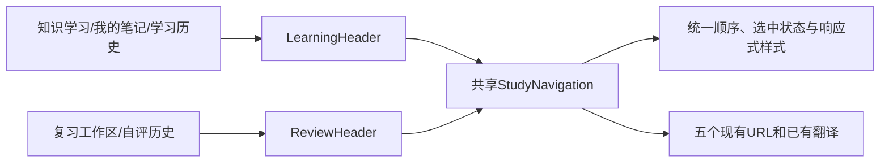

# 学习工作区导航顺序修复方案与实施计划

**目标：** 修复用户截图中切换页面后顶部按钮换位的问题，五个现有入口始终按“知识学习 → 我的笔记 → 复习工作区 → 自评历史 → 学习历史”排列。

**架构：** 两个现有页头使用同一个无业务状态的导航组件；页面显式传入当前栏目，组件复用已有文案、历史URL和Next Link。选中状态只改变颜色与背景，不改变文字尺寸。

**技术栈：** 现有Next/React、TypeScript、CSS Module、Vitest与Playwright，不新增依赖。

**方案依据：** 用户2026-10-15确认“顶部这组导航按钮应保持固定顺序”；延续[第三阶段方案](../specs/2026-10-14-page-beauty-design.md)的展示层边界。

## 修改文件

- 新增 `frontend/src/components/study-navigation.tsx`、`frontend/src/styles/study-navigation.module.css`、`frontend/src/components/study-navigation.test.tsx`。
- 修改 `frontend/src/features/study/managed-learning-view.tsx`、`frontend/src/features/study-review/queue.tsx`，替换两套导航；删除两个原CSS模块内已无调用的导航规则。
- 在现有 `tests/e2e/page-beauty-learning.spec.ts`、`tests/e2e/page-beauty-cross-browser.spec.ts` 内加入跨页顺序、位置、键盘与语言回归，使现有CI自动执行。
- 新增本计划与验收报告，在 `docs/operations/ui-language-coverage.json` 登记共享组件的当前版复习双语场景覆盖；精确更新兼容性摘要清单和策略摘要，不改原基线、快照或旧门禁语义。

## 可行性与兼容性审查

- 根因：LearningHeader与ReviewHeader各自硬编码四个链接，顺序不同且分别缺少一种历史入口，CSS和选中字重也不同。共享组件可直接消除分歧，无接口改造阻塞。
- 两类历史用途不同：`/learn?view=history`保留学习历史，`/learn/review/history`保留自评历史；统一为五个现有入口，不能合并或替换历史目标。
- 原有两个Header的props、标题、筛选参数和数据加载不变；组件不读取身份、不发请求，所有链接继续关闭预取。API、数据库schema15、路由、学习/笔记/复习状态机与权限不变。
- 统一导航自身最大宽度与居中规则，保持两种父容器下相同的水平位置；窄屏允许按固定顺序换行，选中变化不能改变折行。每个目标至少44px。
- 只修复顶部栏目导航，不修改筛选控件或其他页面布局；本分支不自行合并或上线。
- 已从最新 `origin/master`（caf2da04）创建 `codex/study-controls-alignment`；原前端649项单元测试通过。审查结论：可实施，无阻塞性兼容问题。

## 全局约束

- Native由当前实施者执行；最后一次独立全分支代码与兼容审查。
- 不改依赖、OpenAPI、后端、迁移、业务hook、固定旧前端fixture、原workflow或Playwright预算；所有单次测试小于10分钟，Go设 `CGO_ENABLED=0`。
- 合成账号/专属测试库回归，不修改生产账号、不读取生产私人笔记；仅提交必要证据。

## 审查重点

1. 五个入口在所有Header变体均存在且顺序相同；学习历史与自评历史不能串路由，恰有一个当前页标记。
2. 不同父容器、选中字重、语言、320宽与真实引擎下，导航水平位置、相对行位置和键盘顺序保持稳定，不横溢。
3. SSR/客户端、身份隔离、原笔记与默写命令、旧入口跳转不受影响；兼容清单仅登记本次精确路径和字节。

## Task 1：统一顶部导航并验证交付

**接口：** `StudyNavigation({active}: {active: 'knowledge' | 'notes' | 'review' | 'review-history' | 'learning-history'})`，仅返回现有五个Link。两个Header保留原接口。

- [x] 先写五个Header变体×中英文共10个真实组件测试，验证链接顺序、名称、目标和唯一选中态；运行并观察旧实现失败（Expected：4个链接且顺序不一致）。
- [x] 实现共享组件与样式，接入两个Header并移除仅供旧导航的CSS；运行同一测试（Expected：10项通过）。
- [x] 在原视觉spec增加跨五页浏览器回归，验证固定顺序/高亮/水平与相对行几何、44px、无横溢以及Tab顺序；覆盖1280、390、320、中英文及Chromium/Firefox/WebKit（Expected：全部通过）。
- [x] 完整前端单元、类型检查、构建、原工具门禁和相关学习/笔记/复习回归；在现有480秒预算内拆分命令（Expected：各自退出0）。
- [x] 精确登记兼容摘要，保存中文验收报告与代表截图；提交 `fix: 统一学习工作区顶部导航顺序`。Task完成命令：`node tools/verify/run.mjs --cwd frontend -- npm test`（Expected：退出0）。

**计划自审：** 单任务无跨任务接口；所有入口与文案已存在，新增可见的第二类历史入口是固定统一导航所需。回归检查用户可观察行为，不镜像CSS声明。暂无阻塞项。

## 任务后交付门禁

独立全分支代码和兼容审查，重要问题做一次测试先行修复；通过后推送分支、创建MR并附到本任务，核对准确HEAD的全部CI。本阶段不合并、不部署。远端结果在MR与当前会话交付，不把本地验收当作远端已通过。
