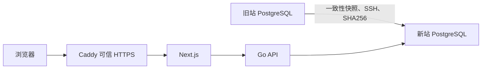

# 服务器迁移计划

目标：将现有网站及全部 PostgreSQL 数据从 43.135.142.53 迁移至 43.172.85.104，保留账号、权限、学习记录与内容状态。

## 架构与文件

修改 `ops/common.py`、`ops/verify-deployment.py`、`ops/.env.example`、`.github/workflows/deployment.yml` 及相关配置、TLS 测试中的目标地址；更新 `docs/operations/server-preview.md`。新增本计划与迁移验收记录。私有配置和数据库备份不进入 Git。

## 可行性审查

新旧服务器均为 Ubuntu 26.04、x86_64；旧站四服务健康，运行版本为最新 master `3db8a55`；新机内存约 3.6 GiB、可用磁盘约 51 GiB、80/443 空闲，具有免交互 sudo。复用现有部署、快照校验和隔离恢复工具；应用与数据库结构保持现状，无新增兼容性设计。阻塞条件：快照或恢复校验失败、HTTPS 证书不可签发、公开访问验证失败；遇到这些情况不宣称迁移完成，保留旧站恢复能力。

## 执行步骤

- [x] 读取部署手册；拉取最新 master，创建 `codex/migrate-server-20261028` 分支。
- [x] 将现有配置/TLS 测试目标切为新 IP，确认失败后同步生产配置，运行运维回归（每次最多 9 分钟）。
- [x] 审查配置变更，提交并通过 Git 创建 MR。
- [x] 新机安装 Docker/Compose；生成新的私有数据库凭据。
- [x] 从旧站捕获一致性快照，SSH 传输并核对 SHA256，完成新机隔离恢复演练。
- [x] 准备固定提交的 release 和空数据库；预演阶段新站不启动 api/web/gateway，不开放用户写入。
- [x] 本轮停止旧站应用写入、捕获快照并逐表核对，新站空库恢复通过；公网验证被云侧443阻断后已恢复旧站。
- [x] 最终恢复校验完成后才激活新站公开 HTTPS，防止预演期间的新站写入被最终快照覆盖。
- [x] 完成可信证书、页面、匿名权限、静态资源、40 次只读访问、私有端口、备份计时器及重启验证。
- [x] 新站备份做恢复演练并保存本机站外副本；写入中文验收记录。

## 本轮阻塞与继续执行

新机可信证书和本机40次请求验收通过，两个外部客户端均确认TCP443被云侧阻断。因无云控制台管理连接，已请求用户放行443；期间先停新机应用，再恢复旧站服务和备份计时器。完整事实与继续切换顺序见 `docs/operations/2026-10-28-server-migration.md`。下一轮须重新同步旧站恢复后的最新数据，不能直接使用本轮停写快照完成激活。

旧站保留数据库、镜像和备份，切换完成后保持应用停写，避免两站数据分叉。新地址需重新登录；不重置用户密码、不提取用户会话。

## 完成情况

用户放行443后已按第二轮方案重新同步最新数据；正式激活、公网两轮80次零失败、四服务重启、每日02:00备份、首次备份隔离恢复与持久站外副本均完成。旧站停止应用写入，保留数据库与历史备份。最终结果见验收记录。
