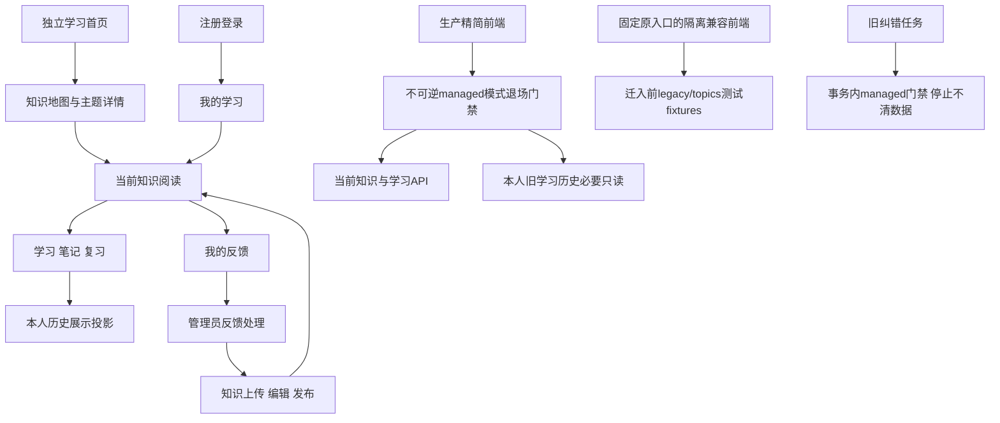

# 网站功能精简设计

## 已确认范围

用户审核了全部37项功能：18保留、8简化、3合并、6移除；两讨论项已确定为独立学习首页和内容更新轻量标记，并在方案后确认实施。

- A01：首页独立展示站点介绍、主题概览及学习入口，不做算法推荐。
- A02/A03/A04/A06、B01至B05：保留地图、主题详情、阅读、搜索、注册登录、个人学习、四种状态、笔记与复习。
- A05：关联知识用名称，来源信息简洁显示并可展开。
- B06：历史以时间、名称、动作为主，编号收进详情；保留本人旧时间线。
- B07：已接触知识更新后显示轻量标记，进度和笔记不重置，完成当前学习或复习后清标记，笔记写入不能清除标记。
- C01/C02：多文件统一预检和确认，汇总新增/归属/重复/冲突/无效项；逐文件独立提交、成功项不重复执行。
- C03/C06/C07/C08：保留未发布暂存、发布/下架/再发布、删除及恢复/直接新建接口；不新增回收站或手工新建页面。
- C04/C05：主题名称筛选，编辑分组，来源及解释用结构化表单，底层规范与手工修正保护不变。
- D01/D03：保留知识反馈、本人反馈、补充沟通。D02/D05/D07：网站反馈并入本人反馈，纠错入口并入管理员反馈处理，提醒并入学习/阅读，不提供独立通知中心。
- D04/E02：管理员处理反馈，业务权限收敛学习者和管理员；旧角色继续可解析，但不自动升为管理员，不授予新版管理权限。
- D06/F01至F05：生产移除旧纠错档案和任务重试、CMS审核版本流程、路线、练习测评、题库与旧板块页面业务；保留必要的历史数据读取及旧URL最小跳转/退场响应。
- E01/E03/E04：保留账户/会话、管理员重置密码、中英文及手机布局。

## 架构

## 数据与接口决策

1. 所有现有知识、归属、账户、学习、笔记、反馈和旧档案数据保留；不改原迁移。分类体系仍为63/534/4969，类别8种、难度1至5，同原始数据ID同主题不重复。
2. TopicPicker使用当前公开目录规范名称，选择值仍为分类键；可单选父主题筛选或多选叶分类编辑，保留语言切换时的值和输入。
3. 历史增加仅用于显示的`title/titleZh/available`投影。当前知识按分页事件的一对一LEFT JOIN提取标题，不返回正文。标题是当前保存的名称，事件SHA/归属/时刻等不改；下架或删除不丢历史、不提供正文链接。旧历史按准确旧身份取名称或显示归档占位。
4. 更新提醒统一详情、列表、概览语义：优先最近完成学习/复习的确认ref（比较对应时刻），无确认时使用最早本人事件ref；保存或删除笔记不覆盖基准。
5. 上传保持单文件64MiB、100条、现有previewToken和幂等回执。多个文件不是跨文件原子事务；刷新后可查已经提交的结果，未应用文件需要重新选择。
6. 旧角色枚举继续支持读取；managed业务写权限只认admin。业务身份与旧数据身份分开，不自动改已有用户权限。
7. 当前生产以不可逆managed内容模式为权威。退场API与纠错事务及worker门禁使用该权威状态；迁入前legacy/topics隔离兼容状态继续执行既有回归。未知状态fail closed。
8. 当前历史仍使用`/api/v2/study/history`必要读取。其他旧业务界面不进入生产依赖图；固定原页面快照仅用于独立兼容前端构建，不能通过生产环境变量启用。
9. API严格schema新增投影须与前端schema/生成类型同批审查、同版本部署；保留身份、CSRF、幂等与并发保护。

## 文件范围

- 新增TopicPicker、结构化来源/解释编辑组件、当前首页组件和样式。
- 修改site-header/auth-status、current-knowledge-view、managed-history/pages、知识管理upload/list/edit、反馈处理/人员管理及文案覆盖清单。
- 修改managed/旧历史DTO、store历史和提醒投影、managed退场HTTP门禁、反馈/用户角色授权、纠错事务和runner。
- 生产旧页面缩成最小壳且不导入旧业务组件。新增固定兼容fixture清单、独立前端构建脚本及生产退场/browser产物检查；原39浏览器命令和测试预算保留。
- 精确更新OpenAPI、生成类型、兼容性白名单/摘要及测试；不整体重置原基线。

## 验收

- 普通用户看不到管理员菜单；旧editor/reviewer不能操作新版知识、反馈与角色；现有admin不受影响。
- 首页与地图不同，登录进入我的学习；中英文/320以上手机无溢出，草稿、选择和笔记不丢。
- 多文件一次确认，可暂存；重复/无效/冲突受保护，中断结果可核对，手工修正不被重导覆盖。
- 历史显示名称，保留原事件、旧事实、不可用知识和owner隔离；两个来源独立分页不重放第一页。
- 内容A变B，保存/删除B笔记仍提示；完成/结束复习B才清标记。详情、列表和概览一致。
- managed旧纠错API与后台写入退出，不改旧任务状态或伪造完成；生产前端不包含旧业务页面依赖，兼容构建独立跑旧完整回归。
- 代码及兼容审查、单元/类型/构建/浏览器/必需CI通过后MR合并、固定版本部署；部署前后知识/归属指纹和学习记录不丢失。
