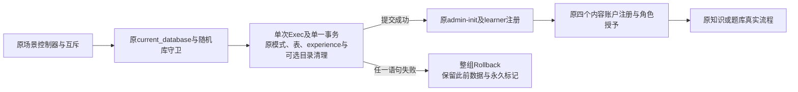

# 共享测试夹具初始化修复方案

用户已明确追加修复：先补方案和兼容审查，通过后按 Native 开发、独立审查、回归及 MR，再继续生产部署。当前生产仍运行 dec8b9e、迁移13；119f0b5仅完成prepare，未迁移或切换。修复分支从最新master 119f0b51feb444ff99bad6629f8809de5ce58e48创建。

## 事实与目标

master前端CI首次在TestContentAcceptanceOldScenesReset的question初始化返回400；一次诊断重跑通过该点，却在note-editor-experience匿名桌面用例的managed-knowledge初始化触及原5秒客户端预算，未进入页面断言。其他7个检查通过。首次底层错误被原夹具包装，不能据此认定具体数据库语句或密码操作就是超时原因。

原用例本机3/3、完整e2etest/testutil以及真实笔记浏览器10/10通过。临时计时副本使用真实Argon2和SQL：managed初始化约0.367—0.428秒，互斥等待41—208纳秒；直接Go阶段约0.393—0.405秒。没有复现CI长尾，因此不修改互斥协议或宣称已经找到具体CI主机延迟来源。临时计时二进制已经恢复，诊断代码不进入产品。

确定的可改进点是共享初始化的存储清理：managed标记复位单独提交，账户关联表清理、experience复位及workflow目录清理又各自隐式提交。workflow入口共四次存储Exec和四次提交。中途失败还可能保留已经提交的模式复位。目标是去掉这些多余提交，同时保证清理失败不会留下半复位状态；是否足够解决远端超时，以原预算下的最新CI为硬门禁。

## 最小架构及文件范围

- 修改backend/internal/e2etest/auth_fixture.go：保留resetAccounts签名，抽取私有resetFixtureStorage(ctx,db,clearCatalogue)及原基础账户初始化。存储清理只用一个真实Tx及一个无参数Exec，失败整体回滚。
- 修改backend/internal/e2etest/workflow_fixture.go：保留resetWorkflow/workflowAccounts签名；消费clearCatalogue=true后再按原顺序创建全部账户。原目录TRUNCATE语句原样保留，只移动到账户创建前的存储事务。
- 新增backend/internal/e2etest/fixture_storage_reset_test.go：真实pgx往返计数、错误回滚、目录/账户及旧会话边界验证；所有测试仅连接本任务专属本机合成库。
- 精确登记上述两个源文件的managed目标、新测试及中文方案/计划/审查记录；不修改历史基线、快照、旧阶段目标或完整迁移摘要。

不修改生产程序、API/DTO、全部14份迁移、密码参数、账户角色、共享互斥、原场景控制器、scene-control、浏览器测试/配置或CI工作流。Go5分钟、命令540秒、普通scene5秒/question内部3秒、浏览器480秒/单worker/零重试保持。

## 兼容及故障边界

保留current_database前缀检查及每条物理连接的OpenVerified校验，不缓存安全结论。只有harness自行创建的随机math_master_test_*库可以执行清理。SQL严格使用原表列表；原账户清理保持RESTRICT，只有原catalogue_versions/knowledge/path_versions/assets语句保留CASCADE，不扩大级联集合。

基础账户初始化仍通过真实admin-init与Register，四个内容账户仍按原顺序走真实注册和ReplaceRoles；所有密码使用原Argon2参数与新随机盐。目录清理前移只改变空库构建顺序：新创建的账户、会话、角色和认证审计不依赖目录表；完整真实流程及会话失效回归必须证明这一点。

仅加强存储清理的失败原子性。后续账号注册和业务种子仍使用各自原事务，不合并服务事务、克隆预置库、复用会话或预先生成批准结果。取消/缺表/外键拒绝时，复位事务必须释放资源，永久managed标记、singleton、表数据及序列一起回滚；原安全错误输出不包含连接凭据或正文。

PostgreSQL17的TRUNCATE及其RESTART IDENTITY支持事务回滚；每个未包入显式事务的语句都会独立提交。这支持聚合存储清理，但不能据此推定CI改善比例。来源：[TRUNCATE](https://www.postgresql.org/docs/17/sql-truncate.html)、[事务](https://www.postgresql.org/docs/17/tutorial-transactions.html)。

## 审查与验收

先在原代码观察四次Exec与中途失败留下模式变化的真实RED，再实现并观察GREEN。原场景重置、全部e2etest/testutil、新笔记十项、分享/安全/双语以及受影响原管理/内容/题库浏览器按原独立预算验证。精确兼容工具、Go vet、生产依赖退场及原API/14迁移逐字节对照必须通过。

进行一次Native独立全补充分支代码与兼容审查，修复阻塞项；新MR最新HEAD全部CI通过后才合并并以最终merge commit重做release归档/prepare。旧119f0b5候选不激活。正式发布继续执行新的一致性备份与恢复、停写快照、迁移14、原数据指纹及Go→Next→可信公网验收。若CI仍在初始化失败，保留精确日志并补充实际阶段诊断，不空重跑、放宽预算或减少用例。
