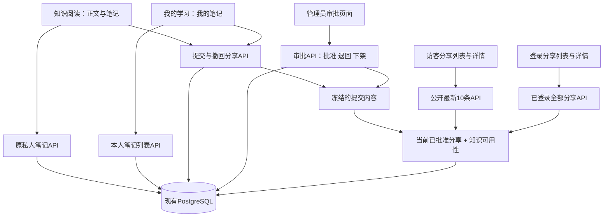

# 第一阶段：笔记优化与审批分享详细方案

日期：2026-10-13。基线：master dec8b9e86499e7ba5dfe49961dfda87ce10a7921。

状态：方案与实施计划审查稿；本轮只交付文档和审查记录，产品实现、数据库迁移、部署分别在后续门禁通过后执行。用户已要求本轮同时整理详细方案、实施计划，并先完成可行性及兼容性审查。

## 1. 目标、已确认规则与范围

网站优先服务用户自己的持续数学学习。本阶段改善写笔记、查笔记、边读边记的体验，并允许作者主动申请分享。

用户已确认：

- 普通笔记默认私有。分享须管理员批准。
- 未登录访客可以查看最新10条已分享笔记；登录用户可以浏览全部已分享笔记。
- 作者更新分享中的笔记前，先撤回分享；修改后重新申请分享并接受管理员审批。
- 本阶段先完成方案、计划、可行性与兼容性审查，再进入开发。

首版继续每个用户、每个当前知识点一份私人笔记。增加我的笔记、编辑与公式预览、分享申请与撤回、分享列表与详情、管理员审批队列。共享内容标注“学习笔记”，明确作者和关联知识。

本阶段不包含自由笔记本、附件、图片上传、协作编辑、评论、点赞、关注、AI生成或改写、复习排期和默写，不恢复旧知识审核、题库或测评。后两项另立下一阶段方案。页面美化只覆盖本阶段涉及的阅读、笔记、分享、审批及必要导航。

## 2. 当前实现与可复用能力

| 已有能力 | 准确入口 | 本阶段处理 |
| --- | --- | --- |
| 本人知识笔记及修订保护 | backend/internal/store/knowledge_admin_notes.go | 原接口与DTO保持；增加事务内分享编辑门禁 |
| 私人笔记数据 | managed_study_notes，主键owner_user_id + knowledge_id | 不改列、原约束或旧迁移，不复制为第二份私人笔记 |
| 笔记限制与安全检查 | backend/internal/study/validate.go、note.go | 保留16000个Unicode字符、65536字节及禁止HTML/图片/危险宏规则 |
| Markdown和KaTeX渲染 | frontend/src/features/reading/safe-markdown.tsx | 编辑预览、个人阅读、分享阅读复用同一受限渲染器 |
| 个人操作与账户边界 | managed-note-editor.tsx、account-boundary.tsx | 保存仍明确点击；保留幂等、冲突和切换账户隔离 |
| 当前知识和个人学习 | CurrentKnowledgeView、ManagedControls、ManagedLearningView | 调整布局，不改四状态、进度分母和内容更新确认语义 |
| 身份、CSRF与事务 | knowledgeIdentity、knowledgeTx | 私有及管理接口复用；新分享模块独立记录幂等回执 |
| 固定结构兼容检查 | managedSchemaDigestSQL、topic-learning-compatibility.mjs | 分享结构独立；只为本次具体文件登记审核后例外 |

现有原笔记API为GET/PUT/DELETE /api/v3/study/knowledge/{knowledgeId}/note。响应ManagedNote保留actorId、knowledgeId、body、revision、knowledge、deleted、available、updatedAt，既有严格Zod解析不添加分享字段。分享元数据使用新接口读取。

现有知识下架后，已有私人笔记可读取，但保存和删除被拒绝。本阶段保留这个行为，不把旧说明中的“仍可编辑”当作实际已支持能力。

## 3. 架构与边界

前端继续Next.js/React/TypeScript；后端继续Go；数据库继续PostgreSQL。无新搜索服务、对象存储、审批worker或新生产依赖。

私人笔记是作者的可编辑原稿；分享提交是不可变快照；分享当前状态是独立记录。管理员读取申请快照，不能读取作者未提交的私人笔记。管理员审批本人提交也须明确点击批准；本阶段不新增独立审核人员角色或禁止自审规则。

## 4. 页面与笔记编辑

### 4.1 我的笔记

入口为/learn?view=notes，位于“我的学习”的栏目中，与知识学习、学习历史并列。只列本人已保存、未删除且正文非空的笔记；空白正文按Unicode空白去除后判断。

默认按笔记updated_at DESC、knowledge_id DESC排序，分页默认20、最大50。支持q、topicKey、shareStatus及游标cursor；q最多128个Unicode字符且512字节，按当前知识中英文标题和本人正文作参数化字面匹配，百分号和下划线不作SQL通配。主题过滤允许合法父主题，复用当前稳定分类键，不按译名判定身份。

每项显示关联知识名称、笔记摘要、更新时间、分享状态和操作。摘要是最多160个Unicode字符的纯文本，不展示原始Markdown语法或完整正文；有公式的正文在详情使用安全渲染。下架知识显示“知识暂不可用”，仍允许查看本人原笔记，不提供公开知识正文或可编辑表单；无活动主题关系时显示“暂无主题归属”。

列表不读取他人的笔记、历史或学习状态。删除后列表移除，已有note-deleted事件照旧保留。

### 4.2 编辑器与阅读布局

- 编辑/预览切换；桌面允许并排预览，手机单栏切换。
- 常用按钮：加粗、斜体、列表、引用、行内公式、独立公式。只插入受限Markdown，不引入富文本格式、HTML、图片或附件。
- 显示字符计数和保存状态：未保存、保存中、已保存、保存失败或结果待确认。超限保留输入并阻止提交。
- 保存继续明确点击，不自动提交、分享或批准。退出/浏览器刷新和站内离开均提示未保存输入；切换语言保留草稿。
- 对于切换账户、会话撤销及迟到响应，清除原账户私有显示和内存草稿，不将正文写入localStorage、URL或跨账户缓存。网络结果不确定时保留原幂等键和输入，通过原请求重试确认；待确认期间禁用新保存、删除与申请分享。
- 在正文上方只保留简洁学习操作。桌面正文为主、笔记侧栏为辅；正文阅读列建议760—840px，侧栏最小280px；不足1100px使用单栏“阅读/笔记”切换。手机默认阅读，不再先展示大空白笔记框。无笔记时显示简短提示和写笔记入口。
- 本阶段只修正阅读页“解释（JSON数组）”“示例（每行一条）”等编辑提示为“解释”“示例”“反例”“常见误区”；管理员编辑页保留必要输入提示。

### 4.3 分享页面

- /notes：未登录时显示最新10条当前有效分享，并提示登录浏览全部；登录时分页检索全部当前有效分享。公开列表不接受分页、搜索或任意limit来扩展10条范围。
- /notes/{shareId}：独立阅读标题、作者用户名、批准时间、正文、关联知识及“学习笔记”标记。shareId是某次提交ID，重新分享生成新ID。撤回、退回或下架的旧链接不重定向到未来新内容。
- 登录列表支持标题/正文q及topicKey，默认20、最大50，使用approved_at DESC、submission_id DESC稳定游标。浏览全部指浏览全部当前有效分享，不包括旧提交或审批档案。
- 作者先预览已保存内容，填写分享标题（去除首尾空白后1—120个Unicode字符）；默认关联知识名称。提交包含准确笔记revision和分享sequence；有未保存输入时先保存，绝不暗中丢弃草稿或仅分享旧正文。
- 公开排名按管理员批准时间及提交ID，更新申请不在批准前挤入最新10条。多主题关系不重复增加同一分享条目。

### 4.4 管理员审批

入口/admin/note-shares。待审批队列默认按submitted_at ASC、submission_id ASC，每页20、最大50，可按pending/shared/returned/withdrawn/hidden筛选。管理员查看冻结正文、标题、作者、关联知识、提交时间和已有处置记录。

批准只操作准确submissionId和head.sequence。退回和管理下架须填写去首尾空白后10—1000个Unicode字符的理由；批准不要求额外理由。管理员不能修改作者正文。审批结果及理由在作者的我的笔记中显示，首版不新增通知中心。

## 5. 状态机与更新规则

| 当前状态 | 作者可执行 | 管理员可执行 | 他人能否查看 |
| --- | --- | --- | --- |
| unshared 未分享（没有head时派生） | 保存、删除、提交 | 无 | 否 |
| pending 待审批 | 查看、撤回申请 | 批准、退回 | 否 |
| shared 已分享 | 查看、撤回分享 | 下架分享 | 当前有效分享可查看 |
| returned 已退回 | 保存、删除、修改后重新提交 | 查看已提交历史 | 否 |
| withdrawn 已撤回 | 保存、删除、修改后重新提交 | 查看已提交历史 | 否 |
| hidden 管理员已下架 | 保存、删除、修改后重新提交 | 查看已提交历史 | 否 |

pending/shared状态下，原笔记PUT和DELETE在后端事务中返回409 NOTE_SHARING_LOCKED，不只禁用按钮。撤回成功后才解锁。撤回待审批和已公开分享均即时生效，对旧审批页执行批准返回409 NOTE_SHARE_STALE。

同一笔记仅一个当前head；批准一个submission只让该快照公开。每次重新提交生成新submission和新审批，不修改历史快照，不重用旧链接。同状态新键重复操作返回409，原键原输入重试返回原回执且不重复生成事件。

批准时间为数据库时钟。审批与作者撤回竞争时以事务序列为准：先撤回则批准冲突；先批准后撤回则最终不可查看。不得因审批重试而重新公开已撤回内容。

关联知识下架或删除期间，该分享从公开及登录分享列表、详情同时不可用；作者和管理员仍可读自己的/已提交的笔记快照。知识恢复公开后，仍处于shared状态的准确快照重新可见；作者撤回和管理员下架的分享绝不因知识恢复而重新公开。知识正文更新不会修改分享快照；详情显示简短“关联知识已更新”提示，笔记不冒充当前官方讲解。

撤回无需关联知识当前可用，避免知识下架后作者无法解除分享。保存/删除则继续遵循原笔记API的知识可用限制。

## 6. 数据与事务

新增迁移db/migrations/00014_note_sharing.sql；开发前若master已有同号迁移，按最新连续号调整文件名和计划引用，不覆盖既有迁移。本阶段不ALTER旧业务表、旧函数或旧触发器。

| 新结构 | 职责与关键约束 |
| --- | --- |
| note_share_heads | 主键owner_user_id + knowledge_id，FK到原笔记稳定主键；status、sequence、current_submission_id、approved_at；合法状态及shared必须有批准时间；当前提交FK包含同一owner/knowledge，防错绑 |
| note_share_submissions | UUIDv4主键；不可变owner、knowledge、note_revision、note_knowledge_ref、title、body、正文SHA256、knowledge标题快照、topic_keys快照、submitted_at；原笔记字符/字节限制；复用不可变触发器禁止UPDATE/DELETE |
| note_share_events | 不可变审批/撤回事件，actor、head身份、submissionId、action、reason、sequence、recorded_at；不复制笔记正文，不写入原学习事件枚举 |
| note_share_receipts | 按actor + action + idempotency_key唯一；保存resource、input_sha256及原结果；同键不同输入返回409 IDEMPOTENCY_CONFLICT；不可变回执 |

note_revision和note_knowledge_ref从已保存原笔记捕获，不能替换成当前知识ref伪造历史。知识标题和主题在提交时单独捕获，仅作分享导航与检索上下文。管理员原始私人笔记接口仍仅返回其本人笔记。

索引：heads的(status, approved_at DESC, current_submission_id DESC)、submissions的(owner_user_id, knowledge_id, submitted_at DESC, submission_id DESC)，以及用于主题过滤的topic_keys GIN索引。首版全文q采用有界分页的参数化字面匹配；不以未测量的吞吐目标承诺大规模全文搜索性能。

统一锁序：原全局身份保护锁 → 操作者身份核验 → 必要的原管理员知识锁 → 知识行 → 原managed_study_records对应owner/knowledge行 → 原note行 → share head → submission读取 → 事件与回执。分享动作与原保存/删除都用同一study record行串行化，不因没有share head就跳过锁。不锁被审批作者的身份行，避免与作者操作形成反向锁序。

提交/撤回使用knowledgeTx(write=true, admin=false)；批准/退回/下架使用knowledgeTx(write=true, admin=true)。原事务8秒、锁等待1秒不放宽。原保存回执确认应先于新的分享状态编辑门禁，以免已成功的保存请求重试被误报为失败；仍保持原身份、内容ref与输入校验规则。

增加独立noteSharingSchemaIntegrity：检查迁移标记、新表、约束、不可变触发器的固定摘要。原managedSchemaDigestSQL和managedSchemaDigest保持。未安装14且新表全部不存在时，原笔记继续可用、分享接口503；14已安装或有任一新表但分享结构不完整时，分享接口及原笔记新写fail closed，既有私人读取继续可用。新分享模块正常安装时才按pending/shared限制原笔记写入。

生产不支持混用旧、新写入二进制。本阶段整组发布前后端与迁移；原deploy.py.rollback已要求实际最大迁移号等于目标release迁移号，14使用后不能直接退回仅含13的release。迁移Down只允许四张新表均为空的隔离库；生产有分享数据后禁止Down。回退使用兼容14的修复release，必要灾难恢复由人工基于核验备份决定，不自动覆盖新增笔记。

## 7. API、权限与缓存

所有新请求继续严格JSON、未知字段拒绝、Origin/CSRF保护；写操作需Idempotency-Key及明确expectedSequence。列表游标最多512字节，绑定endpoint、排序值及q/topicKey/status筛选摘要；筛选变更丢弃旧游标，结构非法或跨筛选游标返回400。游标仅用于排序翻页，不授予访问权限，owner/admin/公开窗口资格始终另行核验。浏览器及SSR请求都由后端核验权限，不依赖页面隐藏。

| 方法与路径 | 身份 | 输入／结果 |
| --- | --- | --- |
| GET /api/v3/study/notes | 本人 | q/topicKey/shareStatus/cursor/limit → OwnNotePage |
| GET /api/v3/study/knowledge/{knowledgeId}/note-sharing | 本人 | → NoteShareHead（含unshared派生，允许本人已有下架知识笔记） |
| POST .../note-sharing/submit | 本人 | expectedRevision、expectedSequence、title → ShareActionReceipt |
| POST .../note-sharing/withdraw | 本人 | submissionId、expectedSequence → ShareActionReceipt |
| GET /api/v3/shared-notes/latest | 公开 | 无查询参数 → LatestSharedNotePage，items至多10，无全库total/cursor |
| GET /api/v3/shared-notes/public/{submissionId} | 公开 | 必须属于请求时最新10条 → SharedNoteDetail |
| GET /api/v3/shared-notes | 登录 | q/topicKey/cursor/limit → SharedNotePage |
| GET /api/v3/shared-notes/{submissionId} | 登录 | 当前有效分享 → SharedNoteDetail |
| GET /api/v3/admin/note-shares | admin | status/cursor/limit → AdminNoteSharePage |
| GET /api/v3/admin/note-shares/{submissionId} | admin | → AdminNoteShareDetail（只能提交快照及操作记录） |
| POST .../{submissionId}/approve、return、hide | admin | expectedSequence，return/hide另含reason → ShareActionReceipt |

所有普通新请求正文上限131072字节；动作submit不传正文，由后端读取已保存笔记。单条详情响应上限1MiB（1048576字节）、分页响应上限4MiB；列表仅摘要不含全文，序列化超限返回503不截断JSON。详情预算覆盖64KiB正文及最多50条审批理由记录，不沿用仅正文的请求预算。HTTP截止8秒，客户端/代理截止10秒；不沿用知识上传64MiB和60秒特例。

新API采用独立notesharing模型与严格schemas；公共DTO无ownerUserId、未分享正文、审批私有理由、个人学习状态或历史。公开详情返回submissionId、title、body、authorName、approvedAt、knowledgeId、knowledgeTitle/titleZh、topicKeys、materialChanged。内部ref和正文摘要只供审批与本人元数据，不作为公开的版本选择功能。

具体响应契约如下，所有对象均拒绝未知字段，时间为RFC3339Nano字符串，sequence/revision为0—9007199254740991整数，ID按上述UUIDv4或知识ID规则验证：

| DTO | 固定字段 |
| --- | --- |
| NoteShareHead | actorId、knowledgeId、status、sequence、submissionId（string或null）、approvedAt（time或null）、lastDecisionReason（string）；没有申请派生unshared/0/null/null/空理由 |
| OwnNoteSummary | knowledgeId、knowledgeTitle、knowledgeTitleZh、topicKeys、excerpt、updatedAt、available、noteRevision、share（NoteShareHead）；正文从原本人note接口读取 |
| OwnNotePage | actorId、items（OwnNoteSummary，最多50）、nextCursor（string或null） |
| SharedNoteSummary | submissionId、title、excerpt、authorName、approvedAt、knowledgeId、knowledgeTitle、knowledgeTitleZh、topicKeys、materialChanged |
| LatestSharedNotePage | items（SharedNoteSummary，最多10） |
| SharedNotePage | actorId、items（SharedNoteSummary，最多50）、nextCursor（string或null） |
| SharedNoteDetail | SharedNoteSummary的字段，另有body；excerpt保留，方便统一严格解析 |
| AuthenticatedSharedNoteDetail | actorId、note（SharedNoteDetail）；登录详情与公共详情的响应类型分开，前端核验actorId |
| ShareActionReceipt | submissionId、knowledgeId、action、status、sequence；这是执行时原回执，重试后必须另读当前head，不能用旧回执覆盖当前状态 |
| AdminSummary | submissionId、authorName、knowledgeId、title、submittedAt、status、sequence |
| AdminNoteSharePage | actorId、items（AdminSummary，最多50）、nextCursor（string或null） |
| AdminNoteShareDetail | actorId、submissionId、authorName、knowledgeId、title、body、noteRevision、noteKnowledgeRef、knowledgeTitle、knowledgeTitleZh、topicKeys、submittedAt、status、sequence、approvedAt（time或null）、events |
| ShareEventSummary | action、actorName、reason、sequence、recordedAt；events默认最近50条，另以eventsCursor精确分页，AdminNoteShareDetail额外包含nextEventsCursor（string或null） |

对应API补充：GET管理员详情允许唯一eventsCursor参数（最多512字节、绑定submissionId）；不把无限审批历史装入单条响应。Head.lastDecisionReason仅本人/管理员可见。SharedNoteDetail中的materialChanged按快照noteKnowledgeRef与当前知识ref比较，不改变历史引用。所有actions的Receipt仅确认原动作，前端刷新head取得当前状态。

新领域错误映射：ErrLocked→409 NOTE_SHARING_LOCKED，ErrStale→409 NOTE_SHARE_STALE，ErrIdempotency→409 IDEMPOTENCY_CONFLICT，ErrNotPublic→404 NOTE_SHARE_NOT_PUBLIC，ErrInvalid→422 INVALID_FIELD；非法查询/游标/重复参数→400 INVALID_REQUEST，超限请求→413 INPUT_TOO_LARGE，缺失或损坏分享结构→503 NOTE_SHARING_NOT_READY。身份、CSRF、密码修改、方法错误继续复用原HTTP状态与错误码。为原笔记写入错误新增唯一ErrLocked映射，调整knowledgeError使其原样传递；不将锁定伪装为原CONTENT_STALE或ID_CONTENT_CONFLICT，也不改变旧错误映射。

公开详情不在最新10条时返回404 NOTE_SHARE_NOT_PUBLIC，在页面显示“该笔记当前无法公开查看，登录后可查看仍在分享中的笔记”；登录后重新请求登录详情，待审/撤回/下架仍404。作者通过本人元数据访问其状态，管理员通过审批接口访问档案，不给分享详情加越权例外。

最新10条和公共详情用同一SQL资格谓词：head.status=shared、当前submission准确匹配、关联knowledge.published=true且deleted_at IS NULL。公共详情先形成ORDER BY approved_at DESC, submission_id DESC LIMIT 10集合，再按ID选择，不能先按ID过滤后LIMIT10。读资格与读取正文在同一只读REPEATABLE READ事务中完成；撤回提交后开始的新请求不得返回旧正文。已交付到用户浏览器的内容不能远程收回，不承诺清除第三方已保存副本。

所有分享响应Cache-Control: no-store；私有/登录/管理响应另加private，页面force-dynamic、fetch cache=no-store，不静态生成笔记详情。已有窗口失去权限时，聚焦/切换可见重新核验并清空失效正文，不发送刷新前的私有HTML给另一账户。失效会话返回401，身份系统不可用返回503，不能降级成匿名后继续展示登录专有内容。

现有knowledge-admin-proxy.ts的privateRoute只识别/admin/、/study/，不能直接用它代理登录shared-notes路径。新增note-sharing-proxy.ts精确登记各路径的方法、public/private/admin属性，v3 catch-all先分派新范围，其他路径继续原代理；公共接口不转发Cookie，登录和管理接口必须转发筛选后的Cookie。GET均拒绝请求正文、转义路径、重复或未知查询参数。

## 8. 文件范围与职责

| 新增／修改范围 | 主要文件 |
| --- | --- |
| 新增分享领域 | backend/internal/notesharing/model.go、validate.go、repository.go及对应_test.go |
| 新增数据实现 | backend/internal/store/note_sharing_schema.go、note_sharing_read.go、note_sharing_write.go、note_sharing_tx.go及_test.go；db/migrations/00014_note_sharing.sql |
| 修改原笔记写入门禁 | backend/internal/store/knowledge_admin_notes.go、knowledge_admin_notes_test.go、knowledge_admin_tx.go；httpapi/knowledge_admin_routes.go仅新增分享锁定错误映射；不修改原ManagedNote和原StudyRepository方法签名 |
| 新增HTTP与注册 | backend/internal/httpapi/note_sharing_routes.go、note_sharing_json.go、note_sharing_test.go；修改application.go、backend/cmd/server/main.go |
| 新增前端协议与代理 | frontend/src/lib/note-sharing/{types,schemas,client,server-client}.ts及测试；lib/api/note-sharing-proxy.ts及测试；修改app/api/v3/[[...segments]]/route.ts |
| 修改阅读笔记与学习栏目 | features/study/managed-note-editor.tsx、managed-controls.tsx、managed-learning-view.tsx、managed-pages.tsx、app/learn/page.tsx、features/reading/current-knowledge-view.tsx及关联测试 |
| 新增笔记UI | features/notes/{note-toolbar,note-preview,own-note-list,share-controls,shared-note-list,shared-note-view,admin-share-queue,admin-share-view}.tsx及对应测试；styles/notes.module.css |
| 新增分享／审批页面 | app/notes/page.tsx、app/notes/[id]/page.tsx、app/admin/note-shares/page.tsx、app/admin/note-shares/[id]/page.tsx |
| 必要文案与导航 | components/site-header.tsx、auth-status.tsx；lib/i18n/messages/{zh-CN,en}.ts、page-titles.ts、error-keys.ts、types.ts；operations/ui-language-coverage.json及原文案覆盖检查 |
| 契约、真实浏览器与门禁 | api/openapi.yaml、lib/api/generated.d.ts；backend/internal/e2etest/note_sharing_fixture.go及harness.go注册；tests/e2e/note-sharing.spec.ts、note-sharing-security.spec.ts、note-editor-experience.spec.ts；frontend.yml、backend.yml中新增有界检查；精确兼容清单 |
| 使用与交付记录 | docs/operations/note-sharing.md、website-guide.md、README.md；specs、plans和reports本阶段文档 |

阅读样式集中在notes.module.css及本次CurrentKnowledgeView布局样式，不全站重写globals.css。不修改固定legacy前端fixture、旧业务URL退场、旧题库/测评规则、分类数据或知识导入去重。

## 9. 验收与审查门禁

1. 原私人笔记完整保留；无申请的本人笔记保存、删除、冲突、超限和幂等行为保持；管理员不能读取他人未提交正文。
2. 未保存输入、语言切换、并发冲突、网络待确认、站内离开和切换账户不丢失或泄露草稿。
3. 申请冻结准确已保存笔记；pending/shared期间PUT/DELETE后端拒绝；撤回后解锁；重提交重新批准，旧链接持续不可用。
4. 访客只能读请求时最新10条批准有效分享；第11条直接URL/API、任意limit/cursor、搜索、重复参数、旧链接均不能越权。登录失效不能继续查看第11条。
5. 两管理员并发批准、审批与撤回竞争、保存与申请竞争、结果未明重试只能产生一组准确快照、决定与事件；旧回执重试不复活分享。
6. 关联知识下架期间本人笔记保留，分享正文不可读；恢复规则与§5一致，撤回和管理下架不自动恢复。
7. Markdown/公式在私人预览、分享详情和审批中一致安全；HTML、危险链接/宏及图片被拒绝，无正文进入URL、日志、浏览器存储或原学习事件。
8. 在1280×900、390×844真实浏览器验证流程；补320px无整体横向溢出检查，长公式仅在局部滚动；双语和键盘操作可用。
9. 旧13份迁移、ManagedNote和学习DTO原结构摘要不变，原managedSchemaDigest不变；新分享schema独立检查；固定兼容构建和生产退场回归保持。
10. 每次命令由tools/verify/run.mjs限制最多540秒，Go另设-timeout 5m、CGO_ENABLED=0；现有Playwright globalTimeout=480000、retries=0保持，不skip/only/取消旧检查。

本轮审查检查方案与计划是否可实施、兼容例外是否明确，不宣称产品测试或性能验证已经通过。产品开发完成后，仍需代码审查、回归、相同HEAD的远端必需CI与Git MR；合并和生产发布分别确认。
