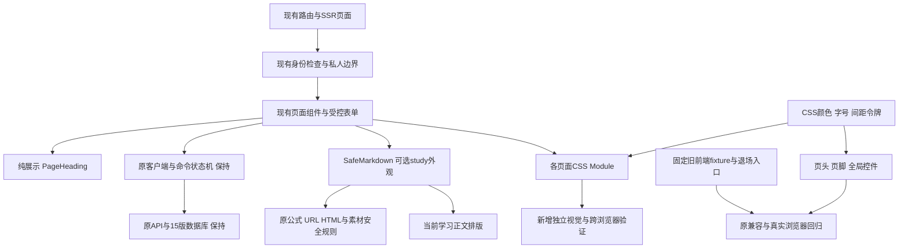

# 第三阶段：页面美感优化方案

状态：方案与实施计划待用户确认，尚未开发。基线为 master `bf8e02c2193ffca1c6534b1991399cacce62ce12`，日期为北京时间2026年10月14日。

关联：[逐页分析](../reports/2026-10-14-page-beauty-page-audit.md)、[实施计划](../plans/2026-10-14-page-beauty.md)、[可行性与兼容性审查](../reports/2026-10-14-page-beauty-plan-review.md)。

## 1. 已确认目标与范围

用户以自己的持续数学学习为优先，已完成笔记审批分享、复习与自行比对默写。本阶段选择“安静的学术阅读”：浅暖底色、克制配色、清晰公式与长文层级。

本阶段改善所有当前页面的视觉一致性，以阅读、私人笔记和复习为最高优先级。保留现有内容、功能、入口和业务事实；不做品牌重建，不增加推荐、社区互动、主题设置或统计系统。先形成详细方案、计划和设计审查，用户确认后按此前Native偏好执行开发。

49个 `page.tsx` 全部纳入盘点：23个当前页面、14个跳转入口、12个退场入口。另单列 `/learn?view=notes`、`/learn?view=history` 两种工作区及全局加载/错误/权限状态。逐页表负责完整覆盖，本方案规定共用尺度及改动边界。

## 2. 现状证据与方案选择

本机用准确基线的现有生产构建、真实测试harness和专属PostgreSQL17.11合成库审阅；25个代表页面/状态各采集中英文及1280、390、320宽度，共150个基线画面。没有访问或复制生产数据库。当前样本无页面级横向溢出，但存在以下改进空间：

- 手机页头高约223.30px，品牌、导航、语言、账户分成四行；学习页叠加本地导航后，正文位置较低。
- `SafeMarkdown` 正文桌面14px、600px以下13px；当前阅读、分享笔记和默写比对均复用它。
- 全局h1最大60.8px，工作区有些覆盖为38px、有些沿用大标题；复习比对的栏目标题与正文反差较大。
- 多种卡片、按钮、标签和字段间距分别定义；有的功能文字只有10—12px。
- `#69756a` 在 `#f8f7f2` 上的对比度约4.497:1，普通文字略低于4.5:1；表单边界与装饰边界没有分开定义。

比较三种做法：

| 做法 | 收益 | 代价与结论 |
| --- | --- | --- |
| 沿用暖白/深绿，统一基础尺度，再逐页精修 | 与现有风格一致；主要改CSS和展示结构；便于保持业务逻辑 | 需要认真处理共享样式影响；本方案采用 |
| 引入完整UI组件库并重写页面 | 容易获得一套新控件外观 | 原生表单、焦点、草稿和兼容前端重写面大，本阶段不采用 |
| 用大插图、渐变、动效重做品牌首页 | 首页变化明显 | 对长时间阅读帮助有限，与已选方向不符，本阶段不采用 |

## 3. 展示架构与数据边界

新增 `PageHeading({title, description?, meta?, actions?})`：四个槽均为ReactNode，输出一个h1及可选区域，不读取身份、数据或路由，不增加Client边界。它与只管理浏览器标题的 `UiPageTitle` 是不同职责，后者保留。

`SafeMarkdown` 只追加可选 `presentation?: 'default' | 'study'`，默认行为保持；`study` 只附加当前正文CSS类，不改解析、数学内容、DOM安全组件或取数。当前阅读、NotePreview及ReviewSections显式采用study；固定旧业务使用默认外观。study同根类采用高于原 `.markdown` 及其媒体规则的显式选择器优先级，不依赖Next样式chunk的加载顺序。当前正文样式与旧阅读布局分开，避免为了放大当前正文而批量重做旧布局。

保留现有所有SSR取数顺序、Provider、组件key、actor核验、挂载位置与状态机。纯视觉任务不得引入额外API请求、持久化、自动保存、参考答案预取或HTML注入。

## 4. 统一视觉规范

### 4.1 颜色、字体与边界

| 项目 | 本阶段约定 |
| --- | --- |
| 基底 | 暖白 `#f8f7f2`，内容面 `#ffffff`，主文字 `#203c2e` |
| 品牌 | 深绿 `#315844`，浅强调 `#eaf0e5`；以文字和选中背景表达层级 |
| 次要文字 | `#5f6d63`，在暖底约5.080:1、白底约5.449:1；替换原边缘对比值 |
| 装饰分隔 | 保留 `#dedfd4`，用于卡片与分区，不用作唯一的输入框边界 |
| 可操作控件边界 | `#858e82`，在白底约3.393:1；使用在输入、选择及工具按钮边界 |
| 焦点 | 深绿3px外描边、3px偏移；保持跳过导航链接与键盘焦点可见 |
| 状态 | 成功 `#315844` 配 `#eaf0e5`、提醒 `#755316` 配 `#faf0de`、错误 `#8c3b28` 配 `#fff5ee`；全部同时显示原文字，不只依赖颜色 |
| 字体 | 继续系统字体与现有本地KaTeX字体；不加载远程字体或新增字体包 |
| 功能字号 | 基础16px；标题、按钮和元数据分级；非装饰、非数学结构的辅助文字至少13px |
| 当前正文 | 桌面17px/1.9，600px以下16px/1.85；主段落宽度最多72ch且不超过父容器 |
| 标题 | 常规页面桌面32—40px、手机28—32px；正文分节桌面22px、手机20px；首页可用更大标题 |
| 空间 | 4、8、12、16、24、32、48px尺度；手机正文卡片20px、桌面28px内边距 |
| 圆角/阴影 | 输入与按钮10px、卡片16px；默认细边框，悬停只用轻微边色/阴影，无位移动效 |

现有 `--paper/--surface/--ink/--muted/--brand/--soft/--border/--radius/--font` 名称保留，映射到新增语义令牌；新增控件边界、危险态和间距令牌。共享基础色和控件变化会影响兼容构建，因此必须跑原回归，不能宣称旧前端像素完全不变。

普通文字目标至少4.5:1；控件可识别边界至少3:1。44px是本项目交互目标，表单主控件48px；它不是把WCAG的24px最低目标要求误写为44px。公式下标、品牌装饰小字不套用普通功能字号断言。

依据：[W3C文字对比](https://www.w3.org/WAI/WCAG22/Understanding/contrast-minimum.html)、[重排](https://www.w3.org/WAI/WCAG22/Understanding/reflow.html)、[目标尺寸](https://www.w3.org/WAI/WCAG22/Understanding/target-size-minimum.html)。这是针对性验收标准，不声称已经完成全站WCAG认证。

### 4.2 页头、导航与响应式

- 桌面保留品牌→主导航→语言/账户的逻辑顺序。把语言与账户归入同一utility区域，手机允许三行布局；长用户名和英文菜单自然换行，不能省略掉功能入口。
- 390宽、普通合成用户名下，两种语言页头目标不超过184px；320宽、长用户名及管理员展开态以全部内容可见、无页面横溢和焦点可达为准，不设高度硬上限。
- 现有管理员手机折叠菜单及三个公开主入口保持。DOM顺序应与阅读/键盘顺序一致，不靠CSS order制造跳跃，不复制两套导航或私人表单。
- 全局容器最大1280px；手机主边距16—20px。普通内容使用正常文档流，不增加全局固定底栏或覆盖软键盘的保存按钮。
- 复用现有关键断点：600表单/手机、760学习侧栏、800比对、1100阅读双栏。只在所属模块调整，不全局改写媒体查询。
- 原阅读在1100以上双栏、较窄屏切换阅读/笔记；原比对在800以上双栏、较窄屏在作答/参考间切换。这两套边界和切换状态保持。

### 4.3 正文与工作区

- 定义、条件、适用范围、证明、解释、例子、反例、来源形成稳定分节；标题与正文分开留白。仅非空的可选内容显示标题，避免空的解释/例子占位；字段与原顺序保持。
- 段落、列表、引用和链接使用同一study正文排版。链接仍可辨识；不替换数学字体、不为断行修改公式源、不对公式强制 `word-break:break-all`。
- 长公式和必要的表格在各自容器内横滚，页面本身不横滚。公式滚动容器在可操作时可获得键盘焦点和可读名称；不把每个短公式变成Tab停靠点。
- 列表优先展示标题和动作，状态、时间、主题等为次层；数据编号保持可获取，不删除或伪装为名称。已有名称直接使用，不为装饰增加解析请求。
- 读、写、待确认、冲突、冻结、自评完成的提示形状一致。状态提示保留原role/live区域及全部恢复按钮；不靠动效表示命令成功。

## 5. 优先顺序与逐页约束

| 优先级 | 页面 | 主要工作 |
| --- | --- | --- |
| P0 | 全局、阅读、私人笔记、复习/默写 | 页头、字体、正文节奏、编辑/冻结/比对层级、按钮与提示 |
| P1 | 我的学习、两类历史、分享笔记、地图与主题、首页 | 导航一致、行列密度、标题/计数/时间层级、卡片与空态 |
| P2 | 登录注册、账户、反馈、管理员知识/人员/笔记审批 | 表单分组、危险动作区分、表格与处理记录、窄屏可读性 |
| 保留 | 14个跳转、12个退场入口 | 保留目标与退出语义，只随共用壳/状态页调整，不恢复旧功能 |

全部入口的具体问题、改动、文件和验收见逐页分析表。下面是不能因视觉优化改变的规则：

1. 私人笔记默认私有；公开只给最新10条已批准笔记；登录后的分享列表、审批、撤回后修改再申请全部保持。不得新增点赞、评论、自动公开或自动再审批。
2. 默写先作答、明确比对后才获得参考；CSS隐藏不等于未揭示，参考不得提前存在于HTML、RSC、DOM或网络响应。空答仅能“忘记”，冻结后不可改写。
3. 三个自评、阶段/间隔、提前复习、改版/下架、请求确认与回执处理全部保持。五个现有队列入口仍为due/unplanned/unfinished/all/future，due计数含changed；视觉不能重定义分类或重排业务优先级。
4. 原四种学习状态、完成事实和进度口径、两个来源的历史游标保持；新自评历史不能变成原学习历史。
5. 复习页现有主题代码筛选仍用原字段与协议；本阶段不偷偷换成新的异步选择器。提升名称选择属于后续交互增强，可另行规划。
6. 管理员知识编辑各组始终挂载；不以标签页或折叠组件卸载受控字段。审批意见、原图/正文、上传预检结果和未确认动作不能因重排丢失。

## 6. 预计新增与修改文件

路径约定：下表中简写的 `styles/`、`components/`、`features/`、`app/` 均相对于 `frontend/src/`；其他写出完整路径的项目相对于仓库根。

| 归属 | 文件 | 责任 |
| --- | --- | --- |
| 新增 | `frontend/src/styles/tokens.css`、`page-ui.module.css`、`current-prose.module.css` | 语义令牌、页面展示尺度、当前正文排版 |
| 新增 | `frontend/src/components/page-heading.tsx` | 无状态、双语槽位兼容的页面标题布局 |
| 修改 | `styles/globals.css`、`components/site-header.tsx`、`styles/auth.module.css` | 页头utility分组、通用控件与账户布局；原AuthStatus身份逻辑保持 |
| 修改 | `features/reading/{safe-markdown,current-knowledge-view}.tsx`、`features/notes/note-preview.tsx`、`features/study-review/self-rating.tsx` | 显式使用study外观、保留安全渲染；当前正文分节 |
| 修改 | `styles/{current-home,catalogue,managed-learning,notes,study-review,content,auth}.module.css` | 当前页面布局、字段、卡片、时间与元数据 |
| 修改 | `features/catalogue/{current-home,current-catalogue,catalogue-search}.tsx` | 首页、地图、主题的展示结构 |
| 修改 | `features/study/{managed-learning-view,managed-history,managed-note-editor,managed-controls}.tsx`、`features/notes/own-note-list.tsx` | 学习工作区、当前私人笔记及本人历史；`managed-pages.tsx`的身份/取数宿主保持 |
| 修改 | `features/study-review/{queue,history,session,recall-editor,comparison,self-rating}.tsx` | 标题/栏目层级、编辑/比对与自评呈现；命令hook保持 |
| 修改 | `features/notes/{shared-note-list,shared-note-view,admin-share-queue,admin-share-view}.tsx` | 分享与审批呈现，不改发布可见性 |
| 修改 | `features/auth/{credentials-form,account-panel,admin-users}.tsx`、`features/feedback/{ticket-list,new-form,discussion-panel,review-panel,status}.tsx`、`features/knowledge-admin/{list,edit,upload}.tsx` | 其余当前表单与列表；各文件只做所属展示调整 |
| 按需精确修改 | 当前23个页面壳、`app/{loading,error,not-found}.tsx`、`components/{content-state,topic-picker}.tsx` | 接入展示类、保持路由和默认导出；不批量格式化无关代码 |
| 新增验证 | `tests/e2e/page-beauty-{public,learning,admin,cross-browser}.spec.ts`、`tests/e2e/page-beauty-helpers.ts`、`tests/e2e/page-beauty.playwright.config.ts`、`frontend/src/components/page-heading.test.tsx` | 视觉/交互边界及独立跨浏览器验证 |
| 新增验证 | `.github/workflows/page-beauty.yml`、`tools/verify/page-beauty-ci.mjs`及对应测试 | 独立workflow；原study-review校验器拒绝同文件追加新job，因此不修改原workflow |
| 精确修改验证 | `docs/operations/ui-language-coverage.json`、`tools/verify/ui-language-coverage.test.mjs`中的无自带文案组件登记、兼容路径/摘要登记 | 只登记PageHeading等实际新增项，不放宽原命令、预算、断言和快照 |

新增页面样式可复用同一Module，不要求每页新建文件。不存在的私人笔记宿主已在审查中纠正，不另建平行实现。

产品禁改区：`backend/`、`db/migrations/`、`api/openapi.yaml`、生成API类型、`frontend/src/lib/`的业务客户端/Schema/命令状态机、现有全部workflow与Playwright配置、生产Compose及部署逻辑、依赖与lockfile、固定旧前端fixture。方案文档新增所需的兼容政策pin是精确登记，不是产品豁免。

## 7. 可行性、性能与兼容要求

- 现有React19/Next16、CSS Module、原生控件及KaTeX足够；不新增产品依赖，不用Canvas承载文字，不增加第三方请求或素材下载。
- 只用现有DTO，UI不增加网络往返；无迁移、无新字段、无存储位置，数据库仍为15。所有身份和缓存边界继承现有实现。
- 以基线相同构建方式测量全部CSS资源gzip总量及代表路由的初始Client JS；增量目标分别不超过10KiB和8KiB，超出须说明归属并优化，不能用更换计量口径通过。
- 验证320/390/768/1280/1440宽度、200%文字放大、1280宽400%缩放等效320布局、reduced-motion及键盘。自动视口测试不冒充真实浏览器缩放/软键盘实测。
- Chromium跑完整视觉矩阵；Firefox/WebKit跑核心路由和长公式/表单/比对冒烟，使用仓库锁定Playwright1.63.0对应引擎。真实缩放/系统字体列入实施人工检查；iOS软键盘有真机时补充抽检，没有设备则明确未覆盖，不凭空新增本阶段的设备采购或硬性门禁，不能拿模拟视口冒充真机。
- 旧兼容前端仍会继承当前未冻结的共享CSS；固定fixture源文件及manifest一字不改，原所有浏览器命令和门禁须继续通过。

## 8. 验收与发布边界

逐页表每行都必须有最终桌面/手机前后对照或明确的保留结论；不以一个首页截图代表全站。基线图不是目标图，截图差异由人工审美审阅结合尺寸/对比度/行为断言判断，不把旧像素原样相等设为验收目标。

必须通过：原类型/单元/构建与全套已有回归、新视觉及跨浏览器用例、精确兼容与语言覆盖门禁、Native最终代码和兼容审查。所有命令≤540秒，Go验证 `CGO_ENABLED=0`、测试 `-timeout 5m`；原Playwright全局480秒、单worker、零重试保持。

开发从届时最新master新建 `codex/page-beauty`，一份MR完成全阶段，先基础与阅读、再其他页面、最后完整回归；本轮文档不创建产品MR。合并、部署需后续对应指令。此次设计不改运维和备份政策，不把上次发布的备份例外当成长期设置。

未来候选与当前 `bf8e02c` 均使用15版数据库时，可以按现有严格健康/HTTPS门禁回切上一15版镜像；不能回到14版 `afff5aa`。发布后再核对Go、Next、公网健康及静态资源，不用视觉版本号代替准确提交号。
