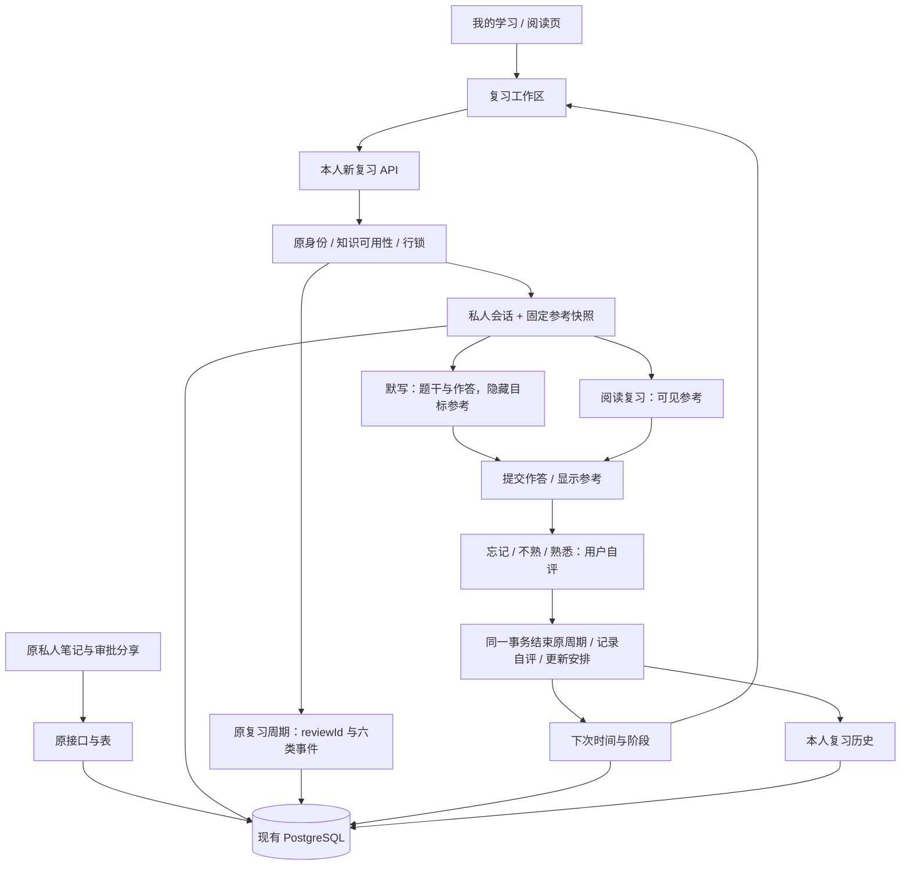

# 第二阶段：复习功能优化与知识点默写详细方案

日期：2026-10-14。基线：master afff5aad42f395d7a1e488796133de74d3a82946（第一阶段已发布版本）。

状态：已完成独立可行性与兼容性审查，初稿7项设计问题及4处精确化细节已关闭，最终无剩余阻塞或延期项。本轮交付方案、实施计划及[审查记录](../reports/2026-10-14-review-recall-plan-review.md)；方案和计划经用户整体确认后，沿用 Native 偏好进入开发。用户本轮明确要求同时整理方案与计划，故合并文档交付环节，产品开发仍保留确认门禁。

## 1. 目标与已确认要求

网站优先服务用户自己的持续数学学习。本阶段形成“选择需要复习的知识 → 阅读或默写 → 自行核对 → 自评 → 下一次复习”的日常闭环。

已确认：默写先作答，答完后自行比对已发布知识内容；比对后按“忘记／不熟／熟悉”自评自动安排下一次复习。首版不自动判分，不根据文本相似度、公式字符串或 AI 生成内容判定数学正确性。

本稿提出的具体排期间隔、默写范围和保存规则是待用户整体审阅的设计选择。完成复习表示一次流程结束，自评表示用户此次感受；二者都不替代原“已学完”事实或构成数学掌握认证。

本阶段包含：复习工作区、到期安排、阅读复习、陈述与条件默写、已有证明的默写、自评、本人复习历史及相关页面布局。继续支持原手动复习与私人笔记、审批分享。

不包含：AI 判题、自动抽取填空、手写识别、附件、公开默写、排行榜、自动提醒、邮件推送、复杂自适应算法、重启旧题库与测评、全站视觉改版。只优化本阶段涉及的学习导航、复习列表、练习与比对页面。

## 2. 现有能力与缺口

| 已核实实现 | 当前语义 | 本阶段处理 |
| --- | --- | --- |
| knowledgeadmin.ManagedRecord / knowledge_admin_study.go | unlearned、learning、completed、reviewing 四状态；开始和结束复习；绑定当前知识 Ref、sequence、reviewId | 保持原 DTO、状态机和原 API；新流程使用同一复习周期事实 |
| managed_study_records / managed_study_events | 已完成事实、复习时间、六类不可变事件 | 不新增旧枚举、不重写旧事件，不把“忘记”改成未学过 |
| /learn?mode=review | 筛选已完成或正在复习的知识，没有到期时间、质量或作答 | 新增独立复习工作区；原链接可继续访问 |
| SourcePoint | statement、conditions、scope、system、equations、proof、proof_scope | 从准确已发布版本提取参考，保留原文本，不生成第二套答案 |
| SafeMarkdown、NoteToolbar、NotePreview、NoteLeaveGuard | 受限 Markdown / KaTeX、输入辅助、导航离开保护 | 复用渲染、工具栏及守卫；默写草稿与私人笔记独立 |
| knowledgeTx、knowledgeIdentity、managedStudyCurrent、readManagedRecord | 原写事务身份保护、内容行锁、8 秒事务、1 秒锁等待 | 新写仓储复用；新私有读单独使用允许行锁的Read Committed事务，不承接原只读RR的撤销竞争语义 |
| migration 14 与独立分享结构摘要 | 笔记冻结、管理员审批、分享权限已经上线 | 分享结构及所有现有迁移逐字节保持 |
| #58 夹具复位 | 一次 Exec、单事务复位，保持真实认证流程 | 在同一 TRUNCATE 中追加新表，保持原顺序、事务及预算 |

## 3. 方案选择

| 方案 | 优点 | 代价 | 结论 |
| --- | --- | --- | --- |
| 独立复习安排 + 复用原复习周期 + 私人默写记录 | 旧客户端继续工作；质量与已完成事实分开；新增功能可独立关闭 | 新增五张表和新接口，需要验证两套入口的并发 | 推荐 |
| 向原记录、原事件和原 DTO 直接追加质量、答案及排期 | 单一查询结构 | 改动严格 Zod、旧约束、历史保护及旧调用者，兼容面更大 | 不采用 |
| 纯浏览器保存答案与复习日期 | 无数据库迁移 | 换设备、清缓存、换账户和历史恢复不可靠 | 不采用 |

推荐方案不增加生产依赖、队列 worker 或搜索服务。Go、Next.js、PostgreSQL、现有身份及安全渲染保持。

## 4. 架构与数据流

新模块 backend/internal/studyreview 负责类型、参考提取及排期算法；store 负责真实原周期与新会话的原子写事务、局部强身份读事务；新 HTTP/Next 代理负责严格路由、鉴权及边界；前端负责作答和人工比对。

不通过调用旧 HTTP 接口串联多次提交，不复刻独立账号权限体系，不让浏览器决定参考正文、内容摘要、周期 ID、排期阶段或真实时间。

## 5. 页面及日常流程

### 5.1 复习工作区

新增 /learn/review，在“我的学习”中增加“复习”入口；阅读页在既有学习按钮附近增加“阅读复习”“知识点默写”入口。原知识学习、我的笔记、学习历史及 /learn?mode=review 保留。

默认“现在待复习”：显示已到期及知识内容已更新的项目；另外可切换“待安排”“未完成”“全部”。首版只对已有 firstCompletedAt、当前仍公开可用的知识开启新复习。旧已学记录首次显示为“待安排”，不伪造旧自评、不批量补历史、不在迁移中突然将所有旧知识设为逾期。

每个知识点只出现一次，多主题关系用 EXISTS 过滤。显示标题、主题、当前内容是否更新、上次自评、下次时间及继续入口。列表不含答案或完整参考正文。支持 q、topicKey、bucket、limit、offset；默认20、最大50、offset最大100000；q最大128个Unicode字符且512字节，字面匹配标题，SQL通配符不扩展。

默认排序：未完成 → 内容已更新 → 已到期 → 待安排 → 未来安排；同组按到期时间、知识ID稳定排序。可用性、分类归属和到期资格按服务器此次查询计算。队列会随操作或内容变化而改变；刷新回第一页，旧页面不构成提交资格。

“未完成”包括新活动会话，或原state=reviewing但没有新会话的原手动复习；后者可明确发起新会话并继续同一原周期。“内容已更新”优先比较已有schedule.lastRef，没有安排时采用原ManagedDetail.materialChanged，不把旧内容更新隐去。各知识按最高优先级只计入一个桶；“现在待复习”筛选已到期及更新两桶，未完成与待安排用独立计数/入口。

显示服务器 asOf 时间，使用“现在待复习”，不以浏览器午夜或本地时钟判定到期。时间在界面按用户浏览器时区展示；排期间隔采用真实经过的秒数。

### 5.2 阅读复习

发起后跳 /learn/review/{sessionId}。显示固定版本的已发布参考和“完成阅读，进行自评”。点击后进入 compared，再明确选自评并提交。阅读模式无作答正文。

可以直接打开原知识阅读页补充学习。复习完成后刷新工作区，提供“继续下一项”，不自动提交下一知识、不强制完成全部队列。

### 5.3 知识点默写

选择“陈述与条件”或“证明”。陈述模式题干只显示知识标题、类型及任务说明；待默写目标为 statement、conditions、scope、system、equations 中实际非空内容。证明模式题干显示原陈述、条件、范围、体系和非空equations，确保“下式成立”的公式命题完整；目标为已有 proof 与 proof_scope。没有实际非空 proof 的知识不提供证明默写；不生成证明或替代空字段。

会话创建时冻结题干、目标参考和准确 Ref。陈述目标、证明目标在查看参考前均不进入该会话的 JSON、SSR HTML 或 React 序列化数据，不能只用 CSS 隐藏。知识本来公开可阅读，因此这是自测流程，不是考试保密系统。

作答支持受限 Markdown、公式、工具栏和安全预览；预览只渲染本人作答。草稿默认留在内存；明确点击“保存草稿”才保存至服务器，支持换设备继续。浏览器存储、URL、日志和分享笔记不保存默写正文。

“答完，查看参考”提交当前输入并冻结当次答案；返回固定目标参考。桌面并排展示“我的作答／参考内容”，手机分栏切换；对照提示包括陈述、条件、适用范围、符号及证明步骤，全部由用户判断。提交之后不能把参考复制回当次答案篡改记录。想再写需要放弃本次并重新发起，不自动复制答案。

空白答案须明确点击“未写出，查看参考”；冻结为空时只能自评“忘记”。阅读复习没有此限制。输入上限为16000个Unicode字符且65536字节，复用原笔记文本与安全校验；不把一次作答保存到原私人笔记或提交分享审批。

有未保存输入时覆盖站内链接、菜单、历史前进后退、刷新和关闭的离开提示。取消离开保留URL、焦点和输入；切换语言、公式预览和同页比对标签不丢草稿。复用 NoteLeaveGuard 的组件接口，不修改原笔记守卫行为。

### 5.4 未确认结果与私人历史

同一账户、知识点最多一个 working 或 compared 会话。重复发起用原键确认；不同输入同键冲突。另一个标签页若已有活动会话，返回准确会话ID，界面提示继续或明确放弃，不能自动覆盖草稿。

发起、保存、查看参考、自评、放弃的所有写接口均返回无正文CommandReceipt；包含actorId、action、sessionId、knowledgeId、reviewId、准确Ref、结果sequence/status/draftRevision、appliedAt，grade另含自评与当时安排元数据。回执不含题干、参考、作答或私人笔记；随后GET当前Session/安排，不能把原回执状态当成当前界面。

每个写动作使用固定幂等键和输入；请求结果未确认时只允许确认原请求。服务器先核验当前身份、合法输入、actor/action/key与资源/输入摘要，命中旧回执即返回原元数据；只有新请求才检查当前Ref、知识可用性、活动状态与CAS。因此完成、放弃、改版、下架后仍可确认原命令，但不会再次修改安排或复活会话。确认写已成功而GET失败时显示“操作已确认，重新读取”，不重发新命令；读取到改版/下架状态按正文投影规则处理。

本人历史使用 /learn/review/history，默认20、最大50，以 gradedAt/sessionId 倒序游标；可筛选知识、主题、自评及模式。列表只含元数据；单次详情显示本人答案、自评、时间和当次内容版本。原 /learn 的学习历史及六种事件不扩展 DTO 或枚举。

历史自评及当次安排来自不可变graded事件/回执，不从后来覆盖的schedule推断；详情分别标注“当次安排”和“当前下次复习”，避免历史被后续复习改写。

匿名、其他账户及仅持有管理员角色都不能读取别人的答案或草稿；越权单项404、未登录401、强制改密403。切换账户、退出及迟到响应立即清除旧账户私人显示和内存输入。所有私有响应 private, no-store；所有新页面 force-dynamic，链接关闭预取。

## 6. 自评与固定排期算法

这是一套首版可解释的安排规则，不宣称测量真实掌握程度或采用科学最优间隔。单一安排按“用户 + 知识点”维护；阅读与两种默写共用，历史保留具体模式和目标。

| 自评 | 新阶段 | 下次时间 |
| --- | --- | --- |
| 忘记 forgotten | 0 | 本次数据库完成时间 + 10分钟 |
| 不熟 uncertain | max(0, 有效阶段-1) | 本次数据库完成时间 + 1天 |
| 熟悉 familiar（首评、已到期或内容更新） | min(5, 有效阶段+1) | 新阶段1/2/3/4/5分别为 +1/+3/+7/+14/+30天 |
| 熟悉 familiar（同内容提前复习） | 保持原阶段 | 保持已有下次时间，防止短时间重复点熟悉连续升级 |

一天等于86400秒。所有三种自评都先计算有效阶段：没有安排或最后评价Ref与当前Ref不同即为0，否则为原阶段；新内容第一次熟悉从1天开始。例：A版本阶段5 → B改版评不熟，是阶段0、次日复习；B次日熟悉是阶段1、再隔1天，不得跳到30天。提前复习的忘记、不熟仍按本次新评价调整。自评一次只能产生一条 graded 事件和一次安排更新。

数据库时间、已存在安排和准确内容Ref作为依据；客户端不能提交 dueAt、stage、gradeAt 或伪造“已经到期”。缺自评不能完成新会话；取消或保存草稿不改变排期。到期并不自动修改旧学习状态或创建事件。

## 7. 原复习周期与新会话的一致性

新发起在同一事务核对当前公开知识和原学习记录。原状态 completed 时按原 StartReview 转移到 reviewing、生成 activeReviewId、记录原 review-started；原已 reviewing 时复用准确 activeReviewId，不重复创建原开始事件。新会话绑定该 reviewId 与准确 Ref。

新自评完成在同一事务再次核对当前 Ref、本人会话sequence及原周期：仍 reviewing 且 activeReviewId匹配时，按原 FinishReview 写原完成事实；若原 API 已完成同一个 reviewId、lastReviewRef一致，直接保留该事实，不重复写原完成事件，然后记录此次自评。若原 API 已开始另一轮，返回409，保留作答，要求刷新处理，不能结束新周期。

新模块在新 store 文件中复用原 TransitionState、读写记录辅助函数及原事件格式；原 ApplyManagedStudy 函数及原接口行为保持。新流程只写合法 review-started/review-finished 原事件，不新增旧枚举，不修改 completedRef、firstCompletedAt 或原首次学习事实。

放弃只结束新会话，不伪造原结束事件或逆转原状态；原 reviewing 是已经开始但未结束的真实事实。下一次可复用同一尚未结束的原周期；已放弃会话不能自评。每个原周期最多一次新自评完成，以数据库唯一约束保证。

## 8. 内容改版、下架与参考边界

新发起、保存草稿、查看参考及自评需当前可用知识；原命令确认先按回执规则处理。参考由服务器从准确Ref提取，不接受客户端参考正文。材料raw上限512KiB指题干与目标条目原文本的UTF-8字节合计，保留原字符串，不包括标题、类型、Ref、摘要、JSON语法或整个JSONB快照；材料摘要另由规范化JSON生成。同时须满足下述实际JSON序列化预算；任一上限不满足，发起在原周期/新会话/事件写入之前返回422 REVIEW_REFERENCE_TOO_LARGE，不截断、不生成摘要。原知识阅读和原手动复习继续可用。

序列化使用新Go HTTP发送所用的同一json.Marshal规则，包含HTML转义。题干只出现在Session.prompt；Reference只包含目标sections与SHA，不重复题干。创建时验证prompt + reference实际JSON合计≤589824字节，预留最大答案393216字节（65536原字节的保守6倍转义）及整个固定元数据/外层envelope≤65536字节；三者合计≤1048576。元数据的准确标量、两语言标题、时间、Ref及最大合法序列须以最大形状验证，不只测初始空值；单项完整标题各≤1024字符且4096字节，过长同样在发起前422。列表标题各至多128字符，超长省略，仅限导航元数据，不截断任何数学题干或参考。

保存/比对仍检查最大答案和精确整体序列化长度，违反不落库；合法请求从创建起已保留足够空间，不能等比对提交后才由代理503拒绝。测试包含引号/反斜杠/HTML转义密集参考、完整大证明题干、最大答案及元数据的组合，真实Go→Next响应须在1MiB内。

内容发生变化时保留本人草稿或已冻结答案，提示“知识内容已更新，需要重新开始”；旧会话不能继续写、显示任何冻结官方题干/目标参考或自评。放弃旧会话无需知识当前可用，再明确发起当前版本；不静默换参考，不默认复制旧答案。

知识下架或删除后，队列不显示目标正文，历史保留本人答案、元数据及“知识暂不可用”；冻结参考也不返回。恢复公开后，同一Ref的历史参考可重新查看，但已放弃会话不会自动恢复。旧Ref历史仅保留本人答案和版本信息，不把已失效内容作为“当前正确参考”展示。

参考快照是内部不可变审计数据，所有交付的官方正文都经过当前知识可用性及Ref相等检查。不论working/compared/completed，只要当前不可用或Ref不同，Session.prompt为空、Reference=null；证明题干内的陈述、条件、范围、体系、公式也全部隐藏，仅保留本人答案和允许元数据。比对或历史打开中若收到改版/下架结果，同步清除题干及参考；再次打开或刷新均重新验证。公开知识本身可见不构成对其他私人答案的授权。

## 9. 数据、事务、容量与接口

新增 db/migrations/00015_study_review.sql（实施前重新拉master确认连续号；若已占用，审查并同步全套版本参数，不覆盖既有迁移）。

| 新表 | 职责与约束 |
| --- | --- |
| study_review_sessions | UUIDv4；owner + knowledge + 原reviewId；mode read/recall、target statement/proof；status working/compared/completed/abandoned；sequence、草稿revision、作答、时间；本人/知识组合FK；活动会话部分唯一索引 |
| study_review_snapshots | session复合FK绑定同一owner/knowledge；不可变准确Ref、标题、类型、题干、目标参考、规范化摘要；材料原文本UTF-8合计最大512KiB，整个快照另遵循明确wire/元数据预算；不复制私人笔记 |
| study_review_schedules | owner + knowledge主键；stage 0..5、dueAt、lastRef、lastRating、sequence、最后自评时间；指向同一用户/知识的有效来源会话 |
| study_review_events | 不可变事件：opened/draft-saved/compared/graded/abandoned；session + sequence唯一；graded对owner + knowledge + 原reviewId唯一；保留模式、Ref和自评，不复制答案正文 |
| study_review_receipts | actor + action + key唯一；resource、输入摘要与原结果元数据；不可变；禁止回执重放重新更新安排 |

DB约束保证模式/目标、状态对应时间、只有compared可grade、完成具备评价、答案长度/字节、所有权复合关联。快照/事件/回执 UPDATE/DELETE 拒绝。sessions 从 compared 后答案不可变，completed/abandoned 禁止再写；所有迁移只新增本模块结构与函数。

会话初始sequence=1、draftRevision=0，opened事件sequence=1。每个新成功写动作sequence+1；draft和compare均draftRevision+1，其他动作不改变该revision；同键确认均不增长。read会话answer=NULL、unanswered=false；recall保存草稿可为空，compare的unanswered必须与去除Unicode空白后是否为空一致，空白不能通过familiar或uncertain完成。

统一锁序：原全局身份锁 → 原身份行 → 当前知识行 → 原study record → schedule → session → snapshot/事件/回执。不同标签和原API使用同一知识/原记录串行化。原8秒事务、1秒锁等待保持；当前内容与提交身份必须在持锁及提交前验证，任一步失败全部回滚。

新写事务仍复用原knowledgeTx。新私有GET使用局部studyReviewReadTx：允许锁的Read Committed事务，8秒/1秒，先取原共享身份保护锁，再knowledgeIdentity(write=false,lock=true,admin=false)，按现有实现锁账户和会话；需要正文时锁当前知识行并在投影后提交前再次检查身份及有效时间。GET不检查写CSRF或幂等键，不更新会话last_seen等业务数据。队列/概览用单条SQL快照得计数/列表，SSR顺序读取而非并发争同一账户锁。

边界明确为事务顺序：撤销或强制改密先提交则拒绝且无正文；读取先取得身份锁，撤销等待或按原1秒锁规则失败，读取按先行事务完成，随后前端清除迟到的旧账户显示。不能设计“撤销已提交，但RR末尾仍以旧快照批准交付”的流程。公开双bool health可用只读RR；原knowledgeTx读实现及旧接口保持，不在此阶段修复旧模块。

主要索引：schedules(owner,due_at,knowledge_id)、sessions活动部分唯一(owner,knowledge_id)、sessions(owner,graded_at DESC,session_id DESC)、events(session_id,sequence)。队列只取标题和安排元数据，分页不返回答题正文；当前主题过滤避免多关系重复行。

新接口族 /api/v3/study/review，Go分发在原study通用分发之前；Next新增独立 study-review-proxy，原managed代理白名单与分享代理保持。

| API | 输入/结果 |
| --- | --- |
| GET /health | 公共能力探测，只返回 capability、schemaReady 两个bool |
| GET /overview | 本人各队列计数及asOf；无答案、参考、其他账户统计 |
| GET /queue | q/topicKey/bucket/limit/offset，metadata列表 |
| POST /sessions | knowledge:Ref、mode、target；创建/复用原周期与独立会话 |
| GET /sessions/{id} | 本人会话、sequence、草稿revision；正文按阶段/Ref/可用性投影 |
| PUT /sessions/{id}/draft | expectedSequence、expectedDraftRevision、body；仅working recall |
| POST /sessions/{id}/compare | expectedSequence、body、unanswered；read时body必须为空且unanswered=false；recall空白须unanswered=true；冻结作答并返回无正文CommandReceipt，随后GET当前会话交付合规参考 |
| POST /sessions/{id}/grade | expectedSequence、rating；服务端安排，返回完成回执和schedule |
| POST /sessions/{id}/abandon | expectedSequence；允许下架后清理本人活动会话 |
| GET /history | 本人分页元数据；具体会话详情使用已有详情接口 |

新请求128KiB，单项响应1MiB，列表响应1MiB；新HTTP/事务8秒、Next代理10秒；拒绝未知/重复参数、GET请求体、错误类型/额外JSON字段、超限及跨源写入。私有接口需要有效已完成改密会话，写入还需CSRF与唯一幂等键。

新增独立 studyReviewSchemaIntegrity 与固定真实结构摘要，不接受运行时重新计算后把任意结构当基线。缺15或部分新结构时，新模块503；原笔记、分享、学习与历史继续遵循原门禁。managed摘要 f81857f4af9a3be336d85f279578df8b 与sharing摘要 2179de9c9ef5b78ec31debb6d5f4fb6c 必须保持；新FK只在新表定义，内部RI触发器不纳入原摘要。

## 10. 文件清单

| 新增/修改文件 | 责任 |
| --- | --- |
| 新 backend/internal/studyreview/{model,repository,schedule,reference,validate}.go 及对应测试 | 新领域、严格类型与算法 |
| 新 db/migrations/00015_study_review.sql | 五表、独立函数/约束/索引 |
| 新 backend/internal/store/study_review_{schema,tx,read,write,cycle,receipt}.go 及对应真实DB测试 | 原子写仓储、局部强身份读与原周期衔接 |
| 改 backend/internal/store/note_sharing_schema_test.go、note_sharing_write_test.go | 原迁移14用例精确锚定14/缺14，不能把新增15的Down误当14 |
| 改 backend/internal/store/knowledge_admin_tx.go | 仅识别新领域错误，旧映射保持 |
| 新 backend/internal/httpapi/study_review_{routes,json,test}.go；改 application.go、knowledge_admin_routes.go、backend/cmd/server/main.go | 接线、新严格路由与能力注入 |
| 改 api/openapi.yaml、frontend/src/lib/api/generated.d.ts | 只追加新路径/组件，不扩展旧 DTO |
| 新 frontend/src/lib/study-review/{types,schemas,client,server-client,pending-command}.ts 及测试 | 新私有契约及结果待确认 |
| 新 frontend/src/lib/api/study-review-proxy.ts 及测试；改 app/api/v3/[[...segments]]/route.ts | 新族分发，原两代理行为保持 |
| 新 frontend/src/app/learn/review/{page.tsx,[id]/page.tsx,history/page.tsx} | 三个动态私人页面 |
| 新 frontend/src/features/study-review/{queue,session,recall-editor,comparison,self-rating,history,pages}.tsx 及测试 | 工作区、作答、人工比对及历史 |
| 新 frontend/src/styles/study-review.module.css；改 managed-learning-view.tsx、managed-controls.tsx、i18n/messages/{zh-CN,en}.ts、page-titles.ts及相关类型/覆盖清单 | 导航与双语；原笔记布局、离开守卫不改 |
| 新 backend/internal/e2etest/study_review_{fixture,control}.go及测试；改 harness.go、auth_fixture.go | 真实场景及原单事务复位追加五表 |
| 新 tests/e2e/study-review-{flow,recall,security}.spec.ts、study-review-helpers.ts | 两视口真实Go/Next/PostgreSQL |
| 改 .github/workflows/{backend,frontend}.yml、tools/verify/{go-batches,topic-learning-compatibility,ui-language-ci,ui-language-coverage}.mjs及精确对应政策/测试 | 添加独立新验证作业，旧命令与预算逐字节保留 |
| 改 ops/deploy.py及对应测试；新 docs/operations/study-review.md、第二阶段验收记录 | 能力15、Go→Next→公网门禁及发布说明 |

实际新文件以开发后的具体diff登记，不先给目录级豁免。文档阶段只登记本轮三份文档的准确摘要。UI文件拆分跟随既有组件结构，不重构无关旧模块。

## 11. 可行性、兼容性与发布门禁

可行性依据：现有字段足够提取参考；原四状态和周期ID支持可重入衔接；同包store辅助函数允许同一SQL事务完成，而无需改旧API；原安全渲染与离开守卫可复用。新领域可独立关闭，不依赖数学自动评分或外部服务。

设计重点：旧手动finish与新自评竞争、同周期唯一grade、更新/下架时隐藏参考、原序列/事实不改、极端内容与容量必须分别证明。开发前须用真实数据库验证新的约束和锁序；源码可行性审查不等同于实现或生产性能已通过。

保持1—14所有迁移、旧API路径/DTO、六事件枚举、原四状态、旧来源档案、原分享默认私有/审批/冻结/撤回/最新10条规则。不能覆盖已有历史快照、放宽保护摘要、跳过旧用例或降低容量。

已有分享迁移测试使用Up(latest)、断言14并Down一次。新增15后必须把该专用schema夹具显式UpTo14；缺14场景明确构造13或隔离DownTo13。保留maxVersion==14、空14可Down、已用14不可Down及缺14原笔记继续可写的断言目的，不改成>=14、不删断言；另增15上原分享可用测试。这两个测试文件只登记受审的准确目标和必要原字节快照，不改旧迁移。

ops当前只接受迁移上限14，必须增加受审的15规则：保持1—14判定；15要求原taxonomy/study/retirement/managed/noteSharing及studyReview能力全满足；16及未来版本拒绝。Go启动后探测新健康，再探测Next代理，激活可信公网后再探测；原readyz形状保持。

上线前捕获一致性全库备份并真实隔离恢复、站外摘要检查；停写后再捕获快照，迁移只新增五空表。逐表核对所有原业务数据、原笔记/学习/分享事实与序列；goose迁移记录和原已证明的健康探测限流变化采用明确规则，不能整表放行。发布后再次备份并真实恢复、复制站外。

迁移15后只允许兼容15的代码修复，不能用旧14二进制直接回退。生产不执行Down、覆盖恢复或删除卷；Down只用于五表为空的隔离测试库。merge与生产部署另按用户授权及准确合并提交门禁执行。

## 12. 验收标准

1. 用户能从到期队列完成阅读复习，或先写陈述/证明、提交后对照原参考并自评；系统不显示自动正确/错误或分数。
2. 固定算法所有区间、早复习、内容更新和重复请求有确定结果，一次自评只改变安排一次。
3. 查看参考前目标答案不出现在会话API、SSR及React数据；之后本人作答冻结，不能以参考覆写当次历史。
4. 原手动入口与新入口交叉完成不重复原事件；不同周期、跨账户、撤销会话、内容改版、下架及未确认写入均正确处理。
5. 原笔记/分享/进度/历史和全部旧回归通过；新模块缺失不会假报复习成功。
6. 真Go/Next/随机PostgreSQL两视口覆盖新三组流程；所有旧CI及新增独立CI通过，每条命令≤540秒、Go5分钟、原浏览器480秒/单worker/零重试不变。
7. 页面键盘操作、长公式、窄屏、双语、草稿离开和账户切换可用。详细实现与对应测试见[实施计划](../plans/2026-10-14-review-recall.md)；审查结论见[审查记录](../reports/2026-10-14-review-recall-plan-review.md)。
