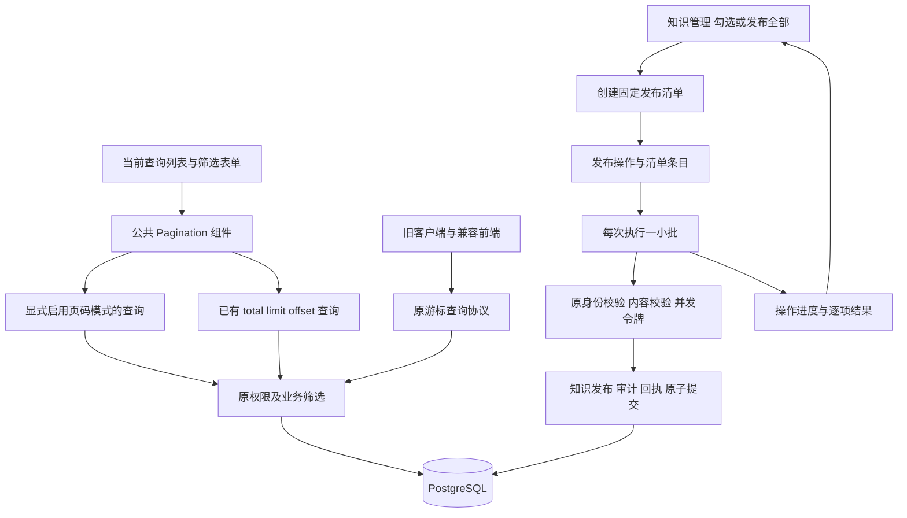

# 查询分页与知识批量发布设计

日期：2026-10-19（北京时间）。状态：用户已确认会话中的功能范围和设计方向；本书面设计待审阅，尚未编写实施计划或产品代码。

开发基线：已执行 `git fetch origin master`，从最新 `origin/master` 提交 `02e6a0b12992b754a15f429bcdb185310eb8a463` 创建分支 `codex/query-pagination-bulk-publish`。沿用 Go、Next.js / TypeScript 和 PostgreSQL。

## 1. 用户目标与已确认边界

1. 全站表单查询列表显示当前页、总页数和总条数，并支持指定页跳转。
2. 首页、上一页、下一页、尾页和跳转使用图标按钮。
3. 表格及列表行内的编辑、发布、下架等动作统一使用文字按钮。
4. 知识管理支持勾选批量发布，以及一键全量发布。

用户已确认：全量发布覆盖整个知识库中当次操作开始时未发布且未删除的知识点，不受当前搜索、主题、难度、类型、状态筛选或当前页限制。操作开始后新建的知识点不加入本次清单。批量发布仅处理明确勾选的知识点，支持翻页后保留选择。

权限、知识内容校验和操作审计继续沿用管理员直接发布规则。编辑已发布知识立即生效、私人学习状态、笔记分享审批以及旧功能退场规则均保持原业务含义。此次代码交付通过 MR 完成；生产迁移、部署及真实全量发布另按实际运行环境执行，测试使用隔离合成数据。

## 2. 现状证据与方案选择

当前分页分为两类：

- 已提供 `total/limit/offset`：知识管理、知识地图及主题详情、我的学习、复习队列、用户管理，以及旧内容与题库列表。
- 仅提供 `nextCursor`：个人笔记、登录后的分享笔记、笔记审批、学习历史、复习历史、反馈、通知和旧纠错列表。

主要代码证据：`features/knowledge-admin/list.tsx` 只有前后页链接及单条发布；`features/catalogue/current-catalogue.tsx` 内有私有 `Paging`；`features/auth/admin-users.tsx` 自行维护翻页请求；`features/notes/`、`features/study/managed-history.tsx` 和 `features/study-review/history.tsx` 只有下一页入口。以上路径均相对于 `frontend/src/`。

后端 `knowledge_admin_tx.go` 对管理员写入使用既有锁顺序及全局知识写锁，事务截止为 8 秒、锁等待为 1 秒。单条发布核对 `editToken`、执行 `ValidateCurrent`、换令牌并记录事件与幂等回执。直接并发发送大量单条发布会竞争同一锁；按“未发布”列表的偏移量边读边发布则会因为集合缩小而漏项。

| 方案 | 评估 |
| --- | --- |
| 公共分页组件、游标接口显式增加页码模式、服务端固定发布清单并串行分批执行 | 统一交互；旧客户端仍可使用旧协议；发布规模与单请求时限分开。本设计采用 |
| 每个页面自行实现分页，浏览器遍历全部记录后逐条发布 | 页面重复逻辑多；采集期间排序变化可能漏项；刷新后难以准确确认执行结果 |
| 全站替换游标协议，全量发布使用单个长事务 | 旧客户端和书签迁移成本高；大量内容校验无法保证在现有短时限内完成 |

## 3. 架构与职责

前端负责分页展示、链接或回调导航、选择状态、串行驱动批次、展示进度及恢复入口。服务端负责真实计数、筛选、固定发布成员、逐项结果、权限和幂等。数据库保存发布操作，刷新页面或请求响应丢失后仍能读取真实结果。

不新增常驻任务进程。一次点击创建操作后，当前页面自动串行请求批次；离开页面停止调度新批次，已经提交的发布保留。重新进入知识管理可读取本人未完成操作，点击“继续发布”恢复。不会在无人打开页面时自动继续发布。

## 4. 查询列表覆盖

| 页面或区块 | 本次处理 |
| --- | --- |
| `/admin/knowledge` | 公共分页、文字行操作、勾选发布和全量发布 |
| `/admin/users` | 公共分页，通过回调保留已应用的用户名查询；角色和密码表单保持原行为 |
| `/knowledge`、`/topics/[id]` | 主题与知识结果分别分页；主题详情的 `offset` 与 `knowledgeOffset` 独立保留 |
| `/learn` 知识查询、复习模式 | 公共分页，保留主题、关键词、学习状态和模式 |
| `/learn?view=notes` | 个人笔记页码查询，保留关键词、主题和分享状态 |
| `/learn?view=history` | 当前历史和展开的早期历史分别分页，保留各自参数与数据来源 |
| `/learn/review` | 各队列及筛选结果使用公共分页，保持队列顺序与计数口径 |
| `/learn/review/history` | 页码查询，保留知识、主题、模式、自评及已有时间语义 |
| `/notes` | 登录用户对有效分享的查询支持完整分页；匿名访问仍只提供最新 10 条 |
| `/admin/note-shares` | 审批队列页码查询，保持现有状态筛选与提交时间升序 |
| `/feedback`、`/review/feedback` | 查询结果页码化，保留访问范围、状态、分类和资料退场筛选 |
| `/notifications`、可访问的旧历史及纠错列表 | 对实际分页的结果接入公共组件，保持原只读和归档边界 |
| 内容、题库的旧查询列表及详情中的成员查询 | 对仍可访问的列表统一分页及文字行操作；已退场入口继续原跳转或 410 |

讨论中的“加载更多”、正文内的关联资料、主题选择器内部取数和非查询型摘要不强制改成独立分页表单。每个实际渲染的查询分页区块都显示页数，即使只有一页；不得以隐藏分页来掩盖缺少总量。

## 5. 公共分页交互

新增 `Pagination`，接收真实的 `total/limit/offset`，以及链接生成器或异步换页回调，两种导航模式互斥。业务筛选、权限和请求协议由调用方负责，组件不拼接任意后端地址。

- 展示“第 X / Y 页，共 N 条”；非空时 `Y=ceil(total/limit)`、`X=floor(offset/limit)+1`。
- 空结果显示“第 0 / 0 页，共 0 条”，所有导航和跳转禁用。
- 提供首页、上一页、下一页、尾页图标；边界按钮保留位置并禁用。
- 跳转输入只接受安全正整数，范围为 `1..Y`；输入后按 Enter 或点击跳转图标执行。空值、小数、负数、超大数和超过总页数均提示输入错误，不发请求。
- 输入页码与已加载页码分开维护；请求失败保留原列表与原页数，清楚显示错误并可重试。
- 查询条件、队列、页大小发生变化时回到第一页。翻页保留已应用条件，不把尚未提交的表单输入误当成当前查询。
- 多个结果区块有独立的无障碍导航名称、页码输入 ID 和参数。翻其中一个区块时保留另一个区块的位置。
- 对已有偏移量接口，链接继续使用所属页面原参数；对新增页码模式使用 `page`。浏览器后退、前进、刷新可恢复查询位置。
- 数据减少后请求页越界，重新定位到最后一个有效页；空集合回第一页入口。已有接口返回仍按原合同，新前端通过一次纠正请求或服务端规范化跳转处理，避免无限刷新。

图标使用本项目绘制的简单内联 SVG，不新增图标包或外部素材。每个图标控制有中文/英文 `aria-label`、悬停提示和可见焦点；禁用链接不保留可触发的 `href`。按钮点击区域沿用项目至少 44px 的交互目标，320px 宽允许换行，页码信息和控件不会造成整页横向溢出。

链接导航保留原有 Next.js 预取禁用策略。异步分页禁用重复提交，并忽略过期响应；身份切换后取消请求，沿用原 actor 校验和账户边界。

## 6. 游标接口的兼容扩展

已有 `total/limit/offset` 接口不改变默认响应。缺少总量的查询接口通过明确参数 `pagination=page` 启用新模式：

| 输入 | 行为 |
| --- | --- |
| 未传 `pagination` | 原游标查询、字段、默认值、排序和错误语义保持 |
| `pagination=page&page=N` | 一开始页码；`page` 为正整数，`limit` 沿用该接口默认值和上限 |
| `pagination=page` | 第一页 |
| `pagination=page&cursor=旧游标` | 新页面打开旧书签时的适配：先校验原游标的身份、范围和筛选绑定，计算锚点在当前结果中的位置，再返回包含该锚点的规范页 |
| 同时传显式 `page` 和 `cursor`，或无效模式 | 按所属接口既有输入错误合同拒绝 |

新模式中页面数据使用 `items/total/limit/offset`，保留原外层 envelope、`actorId`、`asOf` 等具有业务意义的字段；采用独立的页码响应 schema，不向旧游标响应随意增加字段，也不放宽旧客户端的严格 schema。

参数解析、客户端路径校验、Next 代理、OpenAPI 和生成类型同步更新。旧游标的签名、格式和范围检查继续生效，页码模式也必须经过相同的身份与数据可见性检查。匿名分享笔记仍只有最新 10 条，不因增加分页暴露完整分享库。

计数和取页在同一读取事务内，使用完全相同的业务过滤条件及稳定的第二排序键。不能只给当前页条数充当总条数，也不能通过浏览器逐页扫描推测总页数。复习队列的 `asOf` 与隐私边界保持；普通可变列表按每次读取的当前数据展示，不承诺跨请求的内容快照。

分页层只共用参数校验和元数据计算，各业务仓储继续拥有自己的 SQL 条件；不引入可接受任意表名或任意排序表达式的通用 SQL 接口。

## 7. 文字操作按钮与选择

新增明确的文字按钮样式，供表格和查询列表行内动作使用。导航仍用链接语义，写入仍用 `button type="button"` 或正确的表单提交语义，只统一视觉层。编辑、发布、下架、审批和查看等标签保留文字；危险动作同时具有明确文字和危险色。

搜索、上传、表单保存等主动作保留现有主按钮层级。不得全局将所有 `.button` 改成文字样式，从而影响阅读、登录、复习自评和未保存离开保护。

知识管理选择以稳定知识 ID 为键，保存显示名称和当次观察到的 `editToken`，只允许勾选未发布且未删除记录。支持单选、当前页全选、取消当前页、清空全部选择；页头复选框支持部分选中状态。显示跨页选中总数，翻页保留选择；提交新的筛选条件时清空选择并给出提示，避免隐藏选择意外参与新查询。选择只保存在当前页面会话，刷新后通过已创建发布操作恢复执行状态，不持久化尚未提交的勾选。

“发布选中 N 条”和“发布全部未发布知识点”是不同的明确文字动作。全量按钮旁说明它覆盖整个知识库；点击后直接开始固定清单和分批处理，不增加知识审批或版本选择步骤。

## 8. 批量发布数据与接口

新增迁移 `00016_knowledge_publish_batches.sql`，使用独立表保存发布操作、清单和回执，不修改 00001—00015 迁移，不扩展旧导入表的 action 枚举。新表结构完整性检查仅约束新发布操作；未安装迁移时，新功能返回明确不可用，旧读取与单条发布继续按原能力运行。

| 数据 | 职责与约束 |
| --- | --- |
| `managed_knowledge_publish_jobs` | 操作 ID、创建人、模式 selected/all、创建幂等键、输入摘要、创建时间、序列、总数和完成计数；同一创建人和创建键唯一 |
| `managed_knowledge_publish_items` | 操作 ID、知识 ID、期望 editToken、固定顺序、状态及有界错误字段；同一操作和知识 ID 唯一；成员与期望令牌创建后不可变 |
| `managed_knowledge_publish_receipts` | 创建人、动作、操作 ID、请求键、输入摘要和回执；同键同输入重放原回执，同键不同输入拒绝；回执不可变 |

清单保存 ID、令牌和必要显示信息，不复制完整知识正文、私有源文件或私人笔记。发布状态只改变当前知识的发布字段及其原有审计元数据，不生成新的知识身份或修改学习事实。

新增管理员接口：

| 接口 | 输入及行为 |
| --- | --- |
| `POST /api/v3/admin/knowledge/publish-jobs` | `mode=selected` 加唯一的 ID/令牌数组，或 `mode=all`；固定清单并返回操作元数据；创建要求 CSRF 和幂等键 |
| `GET /api/v3/admin/knowledge/publish-jobs` | 分页列出本人操作，供页面刷新后恢复；按创建时间和 ID 稳定排序，支持按创建幂等键精确查询本人操作 |
| `GET /api/v3/admin/knowledge/publish-jobs/{id}` | 返回进度和分页的逐项结果；仅当前仍具有管理员权限的创建人可读取 |
| `POST /api/v3/admin/knowledge/publish-jobs/{id}/step` | 带 `expectedSequence`、`batchSize` 和幂等键，执行下一批并返回逐项结果、剩余数量及新序列；批大小为 1—20，默认 20 |

选中发布每次最多 1000 条，超过时前端在请求前提示；请求体限制为 256 KiB。选中输入核对 ID/令牌格式并拒绝重复 ID，创建时已经不存在的选中记录以失败结果保留，不能静默减少总数。清单只外键关联所属操作，知识 ID 以原格式约束保存，因此能记录知识不存在的结果。全量模式不接收 ID 数组或页面筛选，在数据库中通过 `INSERT ... SELECT` 固定所有符合条件的 ID 和令牌，不受 1000 条选中上限限制。创建与清单写入为一个事务，超时整体回滚，不留下只有部分成员的全量操作。空清单直接返回完成状态和 0 条结果。

全量清单创建使用原知识写锁，与其他知识编辑、导入和状态变更互斥；它只固定成员和令牌，实际发布在后续短事务中执行。每批最多 20 条，服务端限制上限，客户端可缩小至 1 条。批次串行执行，每条处理后释放正文对象，回执只保存结果元数据，不累计 20 份完整正文。每次事务继续 8 秒截止和 1 秒锁等待，页面请求截止沿用普通管理请求的 10 秒。

## 9. 发布规则、失败与恢复

### 9.1 单批原子性

每个批次按原锁顺序获取身份与知识锁，再锁定操作记录并核对序列。条目按固定知识 ID 顺序处理。会话、角色、强制改密规则在提交前复核，不能通过创建时曾为管理员而永久获得执行权。

逐项检查顺序：不存在或已删除记为不可发布；已由其他操作发布的记为已发布跳过；仍未发布但令牌变化记为内容已变更；其余执行原 `ValidateCurrent`。校验失败记录准确字段定位并继续本批其他合法条目。所有成功条目换编辑令牌并写入既有 `managed_knowledge_events` 的 publish 事件，附带发布操作 ID。

知识更新、条目结果、操作计数、序列和本批回执在同一事务提交。数据库故障、截止或锁超时使整批回滚，不把部分条目标为成功。可预期的内容校验结果不是数据库异常；不得在发生数据库错误的已中止事务中继续更新其他条目。

### 9.2 结果与计数

条目状态为 `pending/published/skipped/failed`，其中 failed 附有有界错误码。`total=pending+published+skipped+failed`，前端分别显示已发布、原已发布跳过、失败和待处理数量；失败不能计入发布成功。所有 pending 处理完即结束本轮，failed 大于 0 时显示部分失败。

知识已被修改、删除或内容不合法属于明确失败，分别返回 `CONTENT_STALE`、`KNOWLEDGE_DELETED/NOT_FOUND`、`INVALID_FIELD` 及字段定位，不能自动换成最新令牌重发。页面提供“修正后重新发布失败项”：重新读取原失败 ID 的当前名称、状态和令牌，展示可发布的失败项供用户明确提交，再创建新的 selected 操作。新操作只包含这些失败 ID，不包含旧成功、跳过项或后来新增知识；超过 1000 条按选中上限分组提交。原操作和结果保持不变。

数据库异常导致整批回滚时，条目仍是 pending；页面以原输入、原幂等键重试该批即可。重放必须在期望序列冲突判断之前查原回执。网络响应丢失时保留原批次输入和键，先重放确认结果，再调度下一批，不依据浏览器超时推断失败或重新创建操作。若事务在尝试提交前截止且服务端已确认回滚，新接口返回 503 `PUBLISH_BATCH_ROLLED_BACK`；前端可用新键、同一预期序列将批大小依次缩为 10、5、2、1。批大小计入输入摘要，绝不以原键更换输入。提交阶段连接中断或结果不确定只返回 `REQUEST_INTERRUPTED`，不能冒充已回滚。单条仍超时则暂停并报告；锁忙和临时错误最多连续重试 3 次，随后等待用户继续，避免无限自动重试。

### 9.3 页面生命周期

发布中禁用重复的单条、勾选和全量发布触发，提供“暂停”按钮停止调度下一批；不撤销已经提交的内容。关闭页面、刷新、退出登录或切换账号也会停止调度；已经送出的请求可能完成，恢复时读取服务端进度确认。

浏览器只在当前账号的 sessionStorage 中保存创建请求键和已获得的操作 ID，不保存知识正文、令牌或未提交的勾选。创建响应丢失时，刷新后按原创建键查询本人操作；批次响应丢失时以服务端序列和逐项结果恢复，不能把本地进度当作事实。账号切换清除这些恢复提示，私有读取仍由服务器重新鉴权。

同一个操作被两个标签页恢复时，通过期望序列和行锁防止重复推进，后到请求刷新进度。不同全量操作可能有重叠清单，后处理者将已发布记录计入 skipped。读取他人的操作或绕过管理员权限均拒绝，不向前端返回后台私有来源信息。

## 10. 预计文件范围

下列路径均相对于仓库根；花括号表示列出的同类文件，不表示允许批量改写整个目录。

| 归属 | 文件 | 职责 |
| --- | --- | --- |
| 新增 | `frontend/src/components/pagination.tsx`、`pagination.test.tsx`、`frontend/src/styles/pagination.module.css` | 公共分页、原创 SVG、链接及回调两种导航 |
| 新增 | `frontend/src/lib/pagination/{model,query}.ts` 及对应测试 | 页数和偏移量计算、独立参数保存、输入边界 |
| 修改 | `frontend/src/styles/globals.css`、`frontend/src/lib/i18n/messages/{zh-CN,en}.ts` | 文字按钮、分页和批量发布文案 |
| 修改 | `frontend/src/features/catalogue/current-catalogue.tsx`、`frontend/src/features/study/{managed-learning-view,managed-history,managed-pages}.tsx` | 地图、主题及学习列表接入 |
| 修改 | `frontend/src/features/notes/{own-note-list,shared-note-list,admin-share-queue}.tsx`、`frontend/src/features/study-review/{queue,history,pages}.tsx` | 笔记与复习的查询及分页 |
| 修改 | `frontend/src/features/auth/admin-users.tsx`、`frontend/src/features/feedback/ticket-list.tsx`、`frontend/src/features/notification/inbox.tsx` | 用户、反馈和通知查询 |
| 精确修改 | `frontend/src/features/{content,question,learning,study,correction}/` 中实际渲染旧查询的列表和页面宿主，以及相应 `frontend/src/app/**/page.tsx` | 保留可访问旧查询及归档筛选；不恢复已退场功能 |
| 新增/修改 | `frontend/src/features/knowledge-admin/{list,publish-batch}.tsx`、`frontend/src/lib/knowledge-admin/{publish-batch,client,schemas,types}.ts` | 勾选、操作状态、串行调度、恢复及严格响应校验 |
| 修改 | `frontend/src/lib/{knowledge-admin,note-sharing,study-review,feedback,notification,correction,study}/` 中相关客户端、服务端读取、查询类型与 schema | 明确区分页码和旧游标协议，保留 actor 校验 |
| 修改 | `frontend/src/lib/api/{knowledge-admin,note-sharing,study-review,feedback,notification,correction,study}-proxy.ts` | 新参数与发布操作路径的精准白名单 |
| 新增 | `backend/internal/pagination/` 下参数和元数据模型及边界测试 | 通用数字检查，不承载业务 SQL |
| 修改 | `backend/internal/{knowledgeadmin,notesharing,studyreview,feedback,notification,correction,study}/` 下查询模型及必要仓储接口 | 显式页码模式，不改变旧模式含义 |
| 修改 | `backend/internal/httpapi/{knowledge_admin,knowledge_study,note_sharing,study_review,feedback,notification,correction,study}_routes.go` 及必要查询解析文件 | 参数、兼容响应和新发布操作分发 |
| 修改 | `backend/internal/store/{knowledge_admin_history,note_sharing_read,study_review_read,feedback_read,notification_read,correction_read,study_history}.go` | 真正计数、稳定排序、分页与旧游标锚点适配 |
| 新增 | `backend/internal/knowledgeadmin/publish_batch.go`、`backend/internal/store/knowledge_publish_{jobs,step,schema}.go` 及对应测试 | 发布模型、固定清单、短事务、回执及新表完整性 |
| 精确修改 | `backend/internal/store/knowledge_admin_write.go` | 抽出与单条发布共用的事务内校验和事件逻辑，保留旧接口合同 |
| 新增 | `db/migrations/00016_knowledge_publish_batches.sql` | 发布操作、条目和回执；包含安全回退检查 |
| 修改 | `api/openapi.yaml`、`frontend/src/lib/api/generated.d.ts` | 新查询模式、响应和发布接口；生成文件通过脚本更新 |
| 新增/修改 | `tests/e2e/{query-pagination,knowledge-batch-publish}.spec.ts`、相关单元/仓储/HTTP测试、`backend/internal/e2etest/` 合成夹具 | 桌面、手机、真实后端和隔离数据库验证 |
| 精确修改 | `api/topic-learning-compatibility-baseline.json`、`tools/verify/topic-learning-compatibility.mjs` 以及受影响的其他覆盖/兼容登记文件 | 审核后登记准确的新文件、字节和 API 摘要，保留原断言 |
| 文档 | 本书面设计、后续实施计划与验收记录 | 中文记录方案、兼容性审查和真实验证结果 |

实施计划阶段将“精确修改”进一步展开为任务级文件清单；不修改固定旧前端测试快照，不放宽未知字段检查、超时和兼容性断言来让测试通过。

## 11. 可行性与兼容性自审

| 检查点 | 证据、结论及设计处理 |
| --- | --- |
| 总页数是否能真实计算 | 现有偏移量接口已有总量；游标列表 SQL 已有明确权限/筛选，可在同一读取事务增加 count，不需要扫描到浏览器 |
| 旧响应是否会被严格 schema 拒绝 | 新模式显式启用并使用独立 schema；旧请求保持旧响应，覆盖旧客户端实测 |
| 旧游标书签能否访问 | 新前端通过 page 模式的 cursor 锚点适配；原协议继续可直接调用 |
| 运行时和数据库锁是否允许全量发布 | 固定小型清单后每批最多 20 条，复用原锁顺序与时限，串行执行；不用一个大事务校验全站正文 |
| 清单创建期间并发编辑是否漏项 | 全量清单在既有写锁下用数据库语句原子固定，后续不按正在缩小的未发布集合使用 OFFSET 遍历 |
| 变更后的内容会否被静默发布 | 清单保留期望令牌，未发布条目发生变更则记录失败，不自动采纳新令牌 |
| 当前 schema 指纹能否兼容新迁移 | 既有完整性检查按准确表名计算，新表独立检查，不修改旧表和摘要；迁移 16 不安装时旧功能仍可运行 |
| 原导入表能否直接承担新状态 | 该表 action 有固定 CHECK，因此使用新表，不复用或篡改旧导入枚举 |
| 兼容门禁是否会拒绝新文件 | 当前工具有 Git 文件白名单和 API 精确摘要；实施后逐项登记实际变更，并保留反向旧协议验证 |
| 全量失败能否准确恢复 | 操作、条目和批次回执持久化；原键重放及期望序列避免重复推进，刷新不依赖浏览器内存判断成功 |

设计自审未发现结构性阻塞。大清单创建、精确计数和每批正文校验的耗时必须由实现后的容量回归给出证据；不能将设计可行等同于性能验证已通过。容量目标至少包含 10001 条全量候选、深页跳转和大正文批次，并在数据库故障/超时时验证整体回滚及可恢复行为。若既有时限内无法完成目标数据量，应在继续扩大范围前修正查询或批次实现，不直接放宽截止。

回退策略：新前端依赖的新 API 先部署后端能力；数据库迁移显式执行。回退前停止页面批次调度并等待当前短事务结束，已发布内容保留，不因回退撤销用户操作。仅在无 pending 操作、无处理中请求且保留必要操作回执与审计备份的情况下允许回退新迁移；常规代码回退可保留新表。旧接口和旧数据表不靠回退重写。

## 12. 验收标准

1. 全部纳入范围的查询列表，单页、多页和空结果均显示准确页数及条数；首页、前后页、尾页和指定跳转正常，筛选与多个区块互不串页。
2. 跳转对空值、负数、小数、非数字、溢出和越界输入不发无效请求；删除或发布导致总页数减少时可回到有效页。
3. 中英文和桌面/390px/320px 下图标可识别、焦点可见、键盘可用，文字操作不会意外提交外层表单。
4. 跨页勾选、当前页全选、部分选中、清空和筛选切换符合定义，已发布/删除条目不进入新选择。
5. 全量操作固定整个库的原始未发布清单，排除已发布/删除记录；后续新增不加入，排序变化不漏项；10001 条容量夹具覆盖超过多批的处理。
6. 并发编辑、删除、其他人已发布、单条校验失败均得到明确结果；成功、跳过、失败和待处理之和等于总数。
7. 重复点击、同键重放、不同输入复用键、响应丢失、两个标签页推进、请求超时和刷新恢复均不会重复发布或伪报完成。
8. 普通用户、匿名用户、被撤销管理员、强制改密和跨账号操作不能创建、执行或读取私有发布操作；已有 CSRF、同源和 actor 检查保留。
9. 原游标客户端、旧书签、原偏移量接口、匿名最新 10 条、旧功能跳转/410及原学习/分享/自评规则回归通过。
10. 新迁移安装前后旧能力均按合同运行；新增约束和回执不可变性检查通过，旧迁移原字节保持。
11. 所有 Go 构建、调试和验证使用 `CGO_ENABLED=0`。验证命令通过 `tools/verify/run.mjs` 限制最多 540 秒，Go 单组测试 `-timeout 5m`，浏览器按功能分组，不运行超过 10 分钟的单次测试。
12. 完成代码审查、适配的旧/新协议回归、前端类型检查和构建、真实 Go/PostgreSQL 浏览器验证后，通过 Git 提交分支并创建面向 master 的 MR；报告实际结果与未验证限制。

## 13. 审阅状态与后续交接

本次用户的“确认”批准了此前会话中呈现的方向与范围。本文件补齐了分页协议、固定清单、发布数据结构、失败恢复、文件范围及验收条件，当前等待书面设计审阅。

书面设计确认后，进入实施计划编写，按任务列明准确文件、验证命令、兼容性登记和审查步骤，再按确认的计划执行。不在设计阶段提前修改产品代码或运行真实发布操作。
